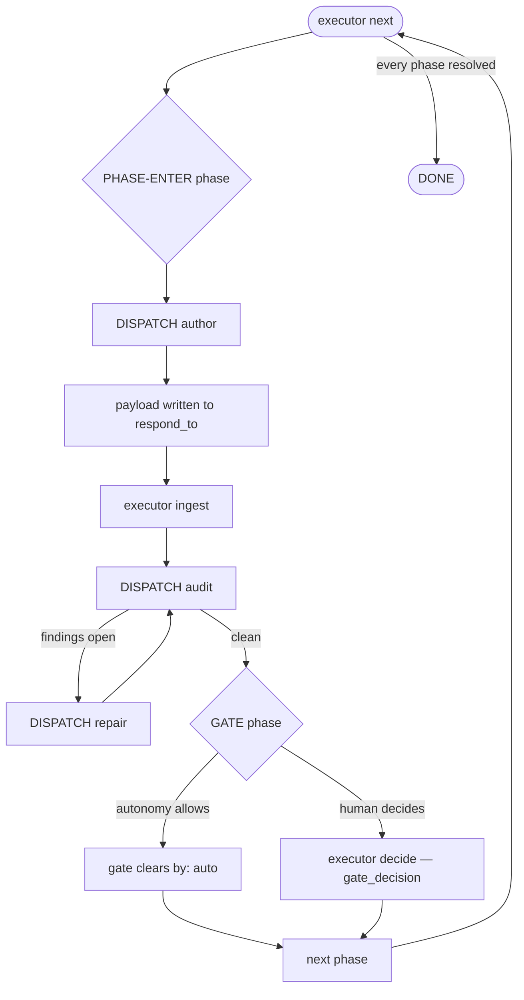
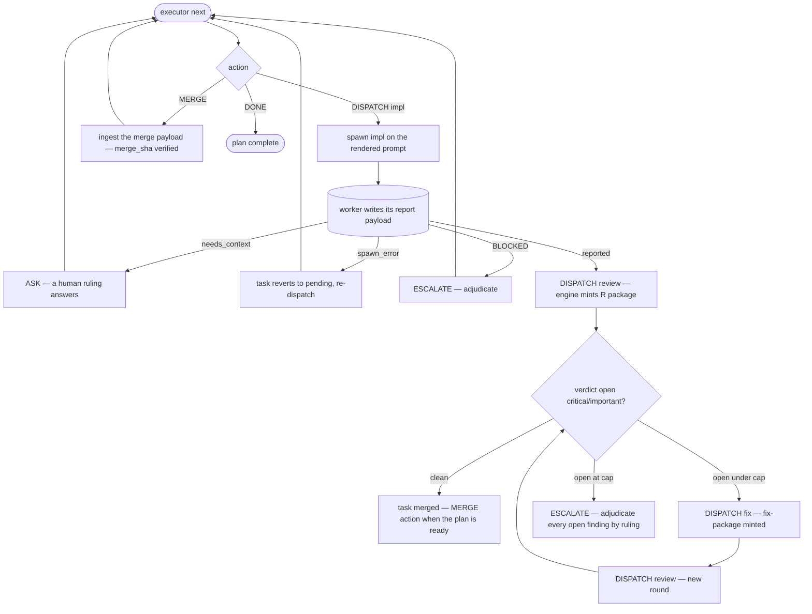
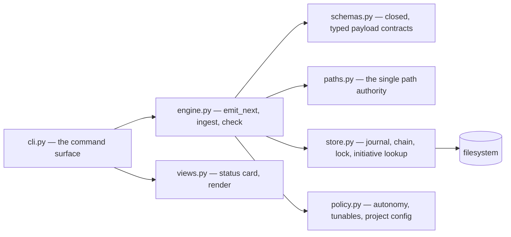
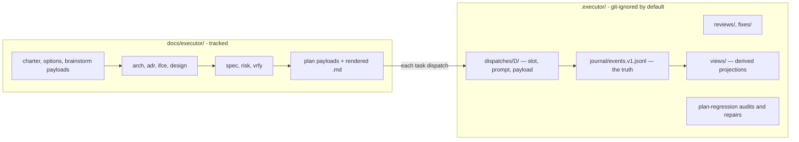

# The Executor

An initiative-scoped workflow system for coding agents: it takes a major
idea from intake through architecture, specification, planning, plan
regression, execution, review, and verification — with a strict
per-initiative ID namespace, separated thinking and execution stores, and
schema-enforced contracts at every state transition.

**Nothing floats.** Every document, task, review, verdict, and ruling
carries an ID that names the initiative it belongs to. A body of work gets
one **Initiative**; the initiative owns a folder, an ID namespace, and every
payload produced about it.

**Nothing is enforced by hope.** Where a workflow could silently drift — a
verdict about a different diff than the one under review, a task completed
without review, a gate cleared by a controller that decided to be helpful —
the engine rejects it, in code, before it lands. Contracts enforced by
prose are hopes; contracts enforced by schemas and a fold are contracts.

Works with any agent that can read skill files from a directory —
Claude Code, Codex, [omp](https://github.com/Atri10/omp), or anything
similar. The skills are markdown; the engine is Python 3.11+, dependency
free, and runs on macOS, Linux, and Windows.

## Install

One line, any of 20+ agents (Claude Code, Codex, Cursor, Copilot, Gemini
CLI, OpenCode, Amp, Goose, and more) — [`skills`](https://github.com/vercel-labs/skills)
discovers every skill in the repo and wires them into your harness:

```bash
npx skills add Atri10/executor
```

Or clone and copy `skills/` into whatever directory your agent loads from,
and put `engine/` on your `PYTHONPATH`:

```bash
git clone git@github.com:Atri10/executor.git
cp -R executor/skills/* <your-agents-skills-dir>/
export PYTHONPATH=<clone>/engine
```

Pin to a release tag instead of `main` for stability:

```bash
git clone --branch v2.0.0 git@github.com:Atri10/executor.git
```

There are no dependencies to install: the engine is the standard library,
and its own test suite needs nothing but Python (plus `coverage` if you
want the branch report — `pip install -r requirements-dev.txt`).

### One-paste install for any LLM agent

Paste this into your agent — Claude Code, Cursor, Aider, Codex, omp, or any
other harness. It discovers the right directories itself and verifies the
install:

```text
Install The Executor skill library and engine for me:

1. Clone https://github.com/Atri10/executor.git into a temp directory
   (use --branch v2.0.0 for the latest release, or the default branch for main).
2. Find my agent's skills directory. Candidates, in order — use the first
   that exists, or ask me if none do:
   - ~/.omp/agent/skills/            (omp)
   - ~/.claude/skills/               (Claude Code)
   - ~/.cursor/skills/               (Cursor)
   - .claude/skills/                 (repo-local Claude Code)
   - as my harness documents
3. Copy every directory from the clone's skills/ folder into that skills
   directory (each is one skill: skills/executor, skills/executor-spec, ...).
   Tell me the PYTHONPATH line that points at the clone's engine/ directory,
   and add it to my shell profile if I confirm.
4. Verify: run PYTHONPATH=<clone>/engine python3 -m executor --version
   (prints 2.0.0), then PYTHONPATH=<clone>/engine python3 -m executor
   --help (lists the command surface). Also confirm every copied
   skills/<name>/ directory contains a SKILL.md — count the directories,
   not a remembered number: the skill set grows, and a stale count fails
   an install that is actually fine.
5. Tell me which directory you installed into, and how to invoke the
   router in my harness (usually /skill:executor or just asking for
   "the executor").

Do not modify any file inside the clone or the skills directory other
than the copy operation itself.
```

Then invoke the root router:

```text
/skill:executor
```

or just say *"start an initiative"* — normal requests route by each skill's
description.

## The phase pipeline

| Skill | Phase | Output |
|---|---|---|
| `executor` | Router + contract | The pump protocol, the ID namespace, the two stores |
| `executor-initiative` | Intake | The `create` payload, the store scaffold |
| `executor-discovery` | Discovery | `options`, `brainstorm` artifacts |
| `executor-architecture` | Architecture, Design | `arch`, `adr`, `ifce`, `design` artifacts |
| `executor-spec` | Specification | `spec`, `risk`, `vrfy` artifacts |
| `executor-planning` | Planning | A `plan` payload: `tasks[]`, `sections[]` |
| `executor-plan-regression` | Plan regression | Plan-set audit, repair, re-audit — gates execution |
| `executor-execution` | Execution | Task dispatches, reports, fix rounds |
| `executor-review` | Review | Per-task and whole-branch `verdict` payloads, findings |
| `executor-verification` | Verification | Evidence payloads per `vrfy` criterion |
| `executor-handoff` | Handoff | Docs export, index, the human's integration decision |
| `executor-brainstorm` | Cross-phase | Recorded divergent ideation sessions |
| `executor-critique` | Every phase (gate) | Per-component audit, repair, re-audit |

**Phases compress, they never vanish.** A small initiative can produce a
charter and a spec in one exchange and skip discovery — but skipping is a
stated human decision recorded as a `ruling`, never an omission. Phase
identity lives in one place (`PHASES` in `engine/executor/store.py`); the
fold, the CLI, and the skills all read it from there.

## The shape of a run

The controller runs one loop and holds no judgment: it runs
`executor next`, reads the single typed action it emits, does that, and
goes back. Every arrow below is either an engine decision or a dispatched
subagent. There is no step where the controller does the work.



The phase order, and which of them carry a critique gate. Every authoring
phase does; the two critique phases audit the others.


### The task loop inside execution

Each plan's tasks run as a loop, and a task's result reaches fold state
only through a review round. A worker that stops is escalated through a
fixed ladder before anyone is replaced.



A worker's result reaches fold state through gates, never through the
controller's memory: the report payload's `result` field, the review
package's `reviewed_package_sha` binding the verdict to the exact diff,
and the fix loop's cap. A report with no verdict yet dispatches the
review — and repeated polling writes nothing.

## Feature highlights

### The journal is the state, and the fold is its only reader

Every accepted payload is one JSON line in
`.executor/INIT-NNNN/journal/events.v1.jsonl`, hash-chained (`prev_sha`,
`line_sha`) — `executor check` recomputes the chain and refuses a store
that was edited by hand. Views (`views/progress.md`,
`views/dispatches.md`, `views/summary.md`, `views/graph.json`, the
rendered `.md` beside each committed payload) are derived projections;
nothing else is state. `state.json` is a cache the engine detects and
refolds when stale.

A dispatch is single-use and answered exactly once: `slot.json` records
the minting event, `prompt.md` is the worker's brief, and `payload.json`
is the `respond_to` path `executor ingest` validates against the `kind`'s
schema. A payload that answers nothing, answers the wrong slot, or claims
a human-only kind is rejected with a named code — never written.

### Every payload is a closed, typed document

`engine/executor/schemas.py` defines each `kind` as a closed object with
anchored patterns: exact ID shapes, back-references tying a task ID to
its plan, numeric bounds pinned by a literal table, and rejections that
name the field, the expected type, and the observed value. A plan cannot
cite a task that does not exist; a verdict cannot name a round the engine
did not mint; a verdict about another diff is `round_mismatch`, not a
numbering slip.

### A payload is data; the engine writes every document

Sections carry four typed shapes — `prose`, `bullets`, `tables`
(`columns` plus `rows`), and `code` — and no string in a payload may
carry markdown syntax. A pipe table, a code fence, or a heading inside a
string is rejected as `notMatch`; a table row whose cell count differs
from its columns is `row_width`; a whitespace-only value is `nonBlank`.
`engine._render_doc` is the only writer of document markdown, so the
store has one renderer and the payload stays checkable. A worker that
wants a table emits rows, not formatting.

Every refusal the engine can emit — 37 of them — is listed in
`skills/executor/references/rejections.md` with its field and the
action that clears it, and `engine/tests/test_docs_agreement.py` walks
the engine's raise sites against that list so a new rejection cannot
ship undocumented.

### Plans are audited as a set, not one at a time

Per-plan review reads one payload. The defects that actually ship live
*between* payloads: an `Assumes` section promising a signature the
predecessor plan never produces, a spec requirement no task claims, two
plans touching the same file with no ordering rule.

`executor-plan-regression` runs between planning and execution and reads
the whole set against the spec, the interface artifacts, and each other —
coverage, seam closure, ordering, constraint propagation, file ownership.
Findings are repaired in the plan payloads themselves, then re-audited.
Execution cannot start until every plan is clean or the human has waived a
finding by `ruling` — enforced by the fold, not by a checklist.

### Reviewers see the package, not a paraphrase

When a task reports, the engine mints `reviews/R<NN>.package.json`:
`commit_base`, `commit_head`, the diff, and every prior finding. The
reviewer's `verdict` payload echoes `round`, `commit_base`, `commit_head`,
and `reviewed_package_sha`; a mismatch is rejected. Two verdicts are
mandatory — `spec_verdict` (PASS/FAIL against the contract) and
`quality_verdict` (APPROVED/NEEDS_FIXES/APPROVED_WITH_ROUTED_RESIDUALS) —
and findings carry `severity`, `claim`, and `evidence` quoting
`path:line`.

### A fix loop with a breaker

Findings are severity-graded: `critical`/`important` enter the fix loop,
`minor` stays `open` for the final audit, `info` is recorded. Each round
is a `fix` dispatch plus a scoped re-review; near the cap the dispatch
goes to a fresh implementer one tier up. At the cap, `ESCALATE` requires
adjudicating every open finding — parked with a journaled `ruling`, never
silently dropped. A fix that weakens a test or deletes what the finding
quoted is a new `critical` finding, not a closure.

### Evidence is capability-aware, not ceremony

The implementer contract asks for the **strongest feasible evidence** for
every behavior change: a watched failing test where a harness exists, a
named alternative instrument where it does not (CLI fixture, parse
check, exercised UI), and an explicit NOT-RUN/UNAVAILABLE record where
nothing feasible exists. The verification phase turns the `vrfy`
criteria into `evidence` payloads with observed output — nothing is
upgraded by inference.

### Upstream drift has a seat

No reviewer ever gets only the diff. The critique catalogs make the
`arch`, `ifce`, and `design` artifacts required inputs of the
implementation critique, and the final reviewer takes them as required
inputs with an architecture-conformance check: where the spec and the
architecture disagree, that is a finding, and the diff alone cannot say
which side is wrong.

### Unattended runs, fail-closed

An initiative declares which phase gates a human agreed to let go
unattended — `executor autonomy`, one JSON map of phase to mode:

```text
executor autonomy                        # the policy in force, every phase
executor autonomy execution allow        # a structural gate may clear itself
```

`deny` is the default for every phase, and every ambiguity resolves to it:
a missing or malformed file, an unlisted phase, a mode spelled wrong. The
pick-class phases (`design`, `specification`), where a human chooses
between options, and handoff never clear automatically whatever the file
says. An auto-cleared gate is journaled as `by: "auto"`, visibly distinct
from a human `passed`.

### The controller carries no weight

The controller is the least reliable worker in the system — it dies,
compacts, drifts, and is under pressure at exactly the moment a judgment
call matters — so the design assumes it will get clever and takes away
the opportunity. It never authors (every artifact is a dispatch), never
judges (every verdict is a payload), never passes a gate (only
`executor decide` writes `gate_decision`, stamped `actor: human`, so a
worker cannot approve its own work), and never improvises a transition
(an action with no row in the decision table is an engine gap to record,
not to approximate).

## How the engine is put together

### The CLI is the whole surface

```text
executor new "<title>"                     scaffold INIT-NNNN
executor next [INIT]                       one typed action + its prompt
executor ingest <path|-> [INIT]            a worker payload: validate → fold → render
executor decide <path|-> [INIT]            a human decision: gate_decision, ruling, resume
executor status [INIT]                     the gate card
executor check [INIT] [--secrets]          chain, edges, liveness, layout; or scan
executor doctor [INIT]                     check + open dispatches + policy in force
executor graph [INIT] [--format json|mermaid]
executor migrate [INIT] [--dry-run]        the store version verdict; never edits
executor autonomy [INIT] [<phase> <allow|gate|deny>]
```

Exit codes: `0` ok · `1` a check found problems · `2` usage or engine
error. Every write goes through `create_initiative`, `ingest`, or
`emit_next`; there is no command that edits the journal directly.

### Module map



`paths.py` is the one path authority: ~40 named `*_file`/`*_dir`
functions, and `classify(rel, store)` parses any path back into
`(store, kind, ids)` — so `executor check` can audit every file in both
stores against the naming grammar and flag drift rather than assume it.

### Versioned, and honest about skew

Each store records the engine version that wrote it in `meta.json`. When
a newer engine opens an older store, commands report the mismatch and say
what `executor migrate` would report — `migrate` never edits the store
itself. A reader of an old journal gets the old fold, not a guess.

### The merge contract

`emit_next` mints `MERGE` as a real slot: the action names the plan, its
branch head, and the `respond_to` path for a `merge` payload. Ingest
verifies the named `merge_sha` exists in the repository, descends from
the plan's head, and binds to the dispatch that answered it. A merge
claim about a commit that does not exist is a rejection, not a
plausible-sounding summary.

## The Two Stores



- **`docs/executor/`** — the thinking record, committed by `executor
  handoff`: the payloads and their rendered markdown, per initiative, per
  artifact, plus the exported journal snapshot. A reader who clones the
  repo gets the complete reasoning.
- **`.executor/`** — the execution record: the journal, the dispatch
  slots, the review packages, the fix packages, and the run views.
  Git-ignored by default, safe to commit if you choose; never deleted —
  the reasoning is the point.

The split is durability-of-audience, not durability-of-value.
`.executor/` resolves from the main repository root, so **removing a
worktree cannot destroy the execution record.**

## The ID Namespace

```text
INIT-0004                      the initiative
INIT-0004-CHTR-01              its charter
INIT-0004-SPEC-01-R07          requirement 7 inside that spec
INIT-0004-P01                  a plan
INIT-0004-P01-T03              task 3 of that plan
D00112                         the dispatch minted by journal seq 112
R2                             review round 2 (an integer on the verdict)
```

`paths.py` enforces these shapes, and a payload citing an ID from another
initiative is a schema rejection. Cross-initiative relationships exist in
exactly one place: the charter's `cites`. Everything else states the
requirement in its own words — an initiative must stay archivable.

## Testing and CI

The engine's suite is Python and runs anywhere Python runs:

```bash
python3 scripts/run_tests.py              # full suite, 100% branch coverage gate
python3 scripts/run_tests.py --no-cover   # no coverage accounting
python3 scripts/run_tests.py -k dispatch  # by name fragment
```

Coverage is branch coverage with `fail_under = 100` in `pyproject.toml`:
a line the tests touch but do not branch is not covered. Adequacy is
audited by mutation testing — `scripts/mutate.py` mutates the AST of the
engine modules and fails if a mutant survives without a recorded reason in
`scripts/mutation-allow.json`.

CI (`.github/workflows/ci.yml`) runs ShellCheck-free, Python-only gates:
the suite under a pinned coverage floor, the skill contract validator,
the prompt-injection lint, and a secret scan.

## Safety

`.executor/` may be committed, so everything in both stores is written as
though it will be public. Credentials, tokens, and personal data never go
into any payload — a redacted existence statement and a safe shape
instead. `executor check --secrets` scans both stores and reports
file:line and the rule, never the value; reviewers treat
credential-shaped content in any diff as a `critical` finding, and a
secret that reached a diff is rotation, not a file edit.
`skills/executor/references/safety.md` carries the policy.

## Project docs

| Doc | Purpose |
|---|---|
| [CONTRIBUTING.md](CONTRIBUTING.md) | How to change skills, references, and the engine |
| [CODE_OF_CONDUCT.md](CODE_OF_CONDUCT.md) | Participation standards and enforcement |
| [SECURITY.md](SECURITY.md) | Reporting vulnerabilities and how artifact secret-hygiene works |
| [CHANGELOG.md](CHANGELOG.md) | Notable changes, newest first |

## License

[MIT](LICENSE)
