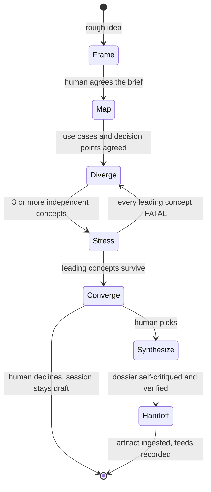

# Executor — Brainstorm

The design skill. Every other skill converges — specs fix requirements,
plans fix tasks, verdicts fix judgments. This one explores first: it turns
a rough idea into a small set of genuinely different, complete designs,
attacks the strongest ones, and lets the human choose with the tradeoffs
in front of them. The output is a `brainstorm` artifact the spec and the
plans are built from.

**Brainstorming is required, not optional.** The `discovery` phase needs
a `brainstorm` artifact before its gate opens, and specification and
planning each need a *decided* session feeding them. A spec written
without a design session encodes the first idea anyone had; a plan set
without a decomposition session encodes the first split.

## When to Use

| Situation | Mode | Feeds |
|---|---|---|
| A new feature, use case, or capability from a rough idea | `design` | `specification` (and often `planning`) |
| Before planning: how the spec splits into plans and tasks | `decision` | `planning` |
| One open question with competing approaches — a state shape, a sync boundary, a storage family | `decision` | the phase that raised it |
| "Let's brainstorm X", inside or outside an initiative | `design` for a feature, `decision` for a question | as recorded |

Not for: gathering requirements the human already knows (discovery's
question loop), yes/no questions (ask directly), or anything the existing
documents already answer.

## Where a session lives

The session IS the `brainstorm` artifact. `executor next` emits
`DISPATCH` with `role: "author"`, `schema: "brainstorm"` when the phase
needs one; the controller runs the session below and writes the
resulting payload to the dispatch's `respond_to`. Every stage's output
lands in the artifact's `sections` — the journal is the record, and the
exported `artifact.md` is the document a reader sees.

Worker outputs — the scout's map, each explorer's concept, the critic's
critique — are session dispatches, not engine dispatches: they report
to the controller, which merges them into the section they answer.
Their prompts are in this directory ([prior-art-scout](prior-art-scout-prompt.md),
[concept-explorer](concept-explorer-prompt.md),
[design-critic](design-critic-prompt.md)); each names the section its
output joins.

Outside an initiative there is no engine yet: run the session as a
plain design document under `docs/executor/`, and when intake creates
the initiative, re-author it as the `brainstorm` artifact — the charter
cites it by name in prose.

## Design mode — seven stages



Each stage ends with something the human agrees to before the next begins
— that is where the questions go, asked on the spot through the harness's
question tool.

### 1. Frame — the brief

Write the `Brief` section with the human, before any concept exists:

- **Problem** — who hurts today, and how you know.
- **Actors** — every person and system that touches the feature.
- **Outcome** — what is true when it works, in the actor's terms.
- **Success criteria** — measurable: a number, a threshold, an observable
  event.
- **Constraints** — hard limits: compliance, platform, budget, deadlines,
  things that must not change.
- **Non-goals** — what this feature will not do, so no concept drifts
  into it.
- **Evaluation criteria, weighted** — how the concepts will be judged
  (e.g. time to ship 3, operational burden 2, user effort 3,
  reversibility 1). Agree the weights now: weights chosen after the
  concepts exist are chosen to favor one.

### 2. Map — the use-case inventory

Write the `Map` section:

- **Use cases** — each with its primary flow, alternate flows, failure
  flows (what happens when a dependency is down, input is wrong, a step
  times out), and abuse flows (what a malicious or careless actor does).
- **Domain** — the entities involved and their lifecycle states.
- **Touchpoints** — where the feature meets existing systems.
- **Decision points** — every design choice the concepts must answer,
  each tagged `one-way door` (costly to reverse) or `reversible`.

Dispatch the **prior-art scout** once the brief is agreed —
[prior-art-scout-prompt.md](prior-art-scout-prompt.md) — and fold its
touchpoints and gaps into the Map.

### 3. Diverge — independent concepts

Pick 3–4 lenses that pull in different directions for this brief, and
dispatch one **concept explorer** per lens, all in one batch, none
seeing another's work — [concept-explorer-prompt.md](concept-explorer-prompt.md)
holds the lens catalog. Always include a **status-quo baseline** in the
Concepts section: what happens if nothing is built. A concept that does
not beat the baseline on the weighted criteria is not worth building.

Summarize each returned concept as a subsection under `Concepts`:
shape, lens, and the one tradeoff that decides it.

### 4. Stress — the adversarial pass

Dispatch the **design critic** on the leading 1–2 concepts —
[design-critic-prompt.md](design-critic-prompt.md). Record every finding
in `Stress test` with its disposition: accepted as a known risk,
mitigated (and how), or disqualifying. If every leading concept carries
a FATAL, return to Diverge with a lens the critique points to.

### 5. Converge — the human picks

Present a decision matrix: concepts as rows, weighted criteria as
columns, each cell a score with a one-line justification, plus the
critic's FATAL and MAJOR findings. Ask the human to pick. Record the pick
in `Decision log`, including what the human traded away. If they decline
to pick, the artifact stays undecided with the open question named — an
undecided session is a real outcome, and it does not feed specification.

### 6. Synthesize — the design dossier

Write the `Design` section for the chosen concept, merged with the
accepted mitigations: shape, the answer to every decision point, the
walk of every use case, a `mermaid` diagram of the primary flow, domain
and data, integration changes, and the MVP slice with its increments.
Then `Risks and open questions`: the critic's accepted risks, the
assumptions that must hold, and every question the human deferred.

### 7. Handoff — what spec and planning receive

Write the `Handoff` section:

| For | What |
|---|---|
| Specification | requirement candidates — one per use-case flow and success criterion, each tagged with the use case it came from; constraints and non-goals carried verbatim |
| Planning | the MVP slice and increments as candidate plan boundaries; the touchpoints each would change |
| Architecture | every one-way-door decision point with its chosen answer — each is an ADR candidate |

Then write the `brainstorm` payload to `respond_to` and run `executor
ingest`. The spec cites the artifact and derives its requirements from
the Handoff; nobody re-litigates a decided session downstream — a
changed mind supersedes it with a new session (a second `brainstorm`
artifact).

## Decision mode — one open question

For one question — including the planning decomposition session, which
becomes a second `brainstorm` artifact in the same initiative:

1. **Generate at least three options** before evaluating any. Two
   options is a false binary; the second-best option exists to make the
   best one argue for itself — write it honestly.
2. **Known-ancestor pass.** For each option, name the closest known
   approach and what it borrows or rejects. Options with no ancestor
   are usually reinvention — flag them.
3. **Adversarial pass.** Attack the favorite: what makes it wrong, what
   it costs at 10×, how it rolls back.
4. **Ask the human to pick**, record `decided:` in the section, set
   `feeds:`.

A decision session runs inline — no session subagents — unless the
question is large enough to deserve a critic, in which case dispatch
one as in design mode.

## The artifact's shape

The `brainstorm` payload carries `id`, `title`, `summary`, `cites`, and
`sections`. Name the sections so a reader can scan them:

```text
Brief | Map | Concepts | Stress test | Decision log |
Design | Risks and open questions | Handoff
```

A `decision`-mode session carries `Options`, `Adversarial pass`, and
`Outcome` instead. `feeds` and `decided` live in the section bodies:
the audit grades a session on them, and an undecided session does not
clear a specification or planning entry.

**A skip is auditable, never silent.** Declining ideation at discovery
entry is recorded in the session record itself; it does not satisfy the
specification or planning entry, which need a decided session.

## Self-Critique

Run this against the artifact's sections before ingesting, and fix what
it catches:

1. **Were the evaluation criteria and weights agreed before any concept
   existed?** If they were set or changed after, the pick was
   rationalized — re-agree them and re-score.
2. **Are the concepts genuinely different?** Name the decision point on
   which each pair disagrees. Two concepts that agree on every one-way
   door are one concept — replace one with a new lens.
3. **Does every one-way-door decision point have an answer in the
   chosen design?** An unanswered one becomes a guess in the spec.
4. **Does every use case — failure and abuse flows included — have a
   walk in `Design`?** A flow with no walk becomes a requirement nobody
   wrote.
5. **Does the chosen concept beat the status-quo baseline** on the
   weighted criteria? If not, the honest outcome is "do not build".
6. **Does every critic finding have a disposition?** A FATAL or MAJOR
   with none was ignored, not accepted.
7. **Is every requirement candidate in `Handoff` traceable** to a use
   case or a success criterion? One that is not is scope the human
   never agreed to.
8. **Did the human make the pick** — recorded in their words in the
   Decision log — or did you decide for them?

## Verification

Before claiming the session is decided:

1. `executor check` — the artifact parses, its `cites` resolve, no
   dangling edges.
2. Every concept the `Concepts` section summarizes came from a session
   dispatch — the explorer outputs are merged, not summarized from
   memory.
3. `feeds` names the phase about to be entered; `decided` is recorded.
4. `executor check --secrets` — exit 0; the payload is durable.
5. Every `mermaid` block in the record renders — quoted labels, a colon
   after every sequence-diagram arrow.

Cite each result in the Decision log. A session is decided only after
these ran in this session.

## Common Rationalizations

| Excuse | Reality |
|---|---|
| "I already know the answer" | Then the design session is fast — but it still runs, because the spec gate needs the brief, the use cases, and the alternatives you rejected |
| "Three explorers is expensive" | A spec and plan set built on the wrong concept costs every task in them |
| "The explorers can see each other's work, it saves time" | Then you get one design with four names — independence is the only reason to dispatch more than one |
| "Two options is enough" | A binary is the most common way to be wrong — generate the third |
| "The human will pick anyway" | The critic's attack is what makes the pick informed; skipping it presents a menu cooked to lose |
| "A skip note is enough" | It satisfies discovery's record; the spec and planning gates need a decided session |
