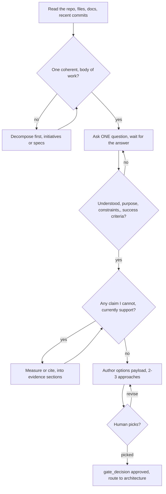

# Executor — Discovery

Discovery answers exactly two questions: **what is actually being asked
for**, and **which approach wins**. Its outputs are the `options`
artifact (the approaches and the pick) and the `brainstorm` artifact
(the recorded design session), plus one human `gate_decision`.

Discovery writes no production code, scaffolds nothing, and installs
nothing. A probe you run to measure something is evidence — it is
recorded as measured in the `options` payload's evidence sections and
the throwaway code stays out of the tree.

| | |
|---|---|
| **Entry** | Charter exists and `GATE intake` passed (`executor-initiative`) |
| **Produces** | the `options` artifact (`INIT-NNNN-OPTS-01`), the `brainstorm` artifact (`INIT-NNNN-BRN-01`) |
| **Exit gate** | `GATE discovery` — the human picks an approach |
| **Next** | `executor-architecture` |

Read the contract before writing anything:
[layout](../executor/references/layout.md) ·
[frontmatter](../executor/references/frontmatter.md) ·
[indexes](../executor/references/indexes.md) ·
[safety](../executor/references/safety.md).

<HARD-GATE>
Do NOT write code, scaffold a project, install a dependency, create a
branch for implementation, or invoke any implementation skill until the
human has approved an approach. This applies to EVERY initiative,
however small. The artifact scales with the task — a tiny initiative's
options payload is three paragraphs. The approval gate never scales.

**This gate ends your turn.** Presenting the options artifact is the
last thing in your message. Working past it — drafting architecture,
reading ahead, preparing anything "for when they pick" — means the pick
you record never happened.

**Inline execution is forbidden in this phase.** If you catch yourself
opening a source file to edit it, scaffolding a directory, or writing a
script "to test the approach" — stop. That is implementation, and it is
what the gate exists to prevent. Probes that produce measurements are
evidence; write what you ran and what you observed into the payload's
evidence sections, and leave the throwaway code out of the tree.
</HARD-GATE>

## Procedure



1. **Read the repo.** Files, docs, recent commits, the charter. Never
   ask a question the repository already answers — it burns the human's
   patience on work you could have done.
2. **Check scope.** Decompose before detailed questions (below).
3. **Ask one question per message** until purpose, constraints, and
   success criteria are clear.
4. **Gather evidence** into the `options` payload's evidence sections
   when a claim needs support.
5. **Author the `options` payload** — the `author` dispatch writes it;
   2-3 approaches, identical axes, one lead recommendation, and what
   would change it.
6. **Run the design session** — the `brainstorm` artifact
   (`executor-brainstorm`); the human's pick converges it.
7. **Present and stop.** The `GATE` is the human's pick.
8. **Record the pick** — a `gate_decision` via `executor decide`.

## Dialogue Discipline

This is the highest-value part of discovery. A wrong approach chosen
from a well-run dialogue costs one initiative; a right-looking approach
chosen from assumptions costs the whole build and is not discovered
until execution.

| Rule | Why |
|---|---|
| **One question per message. Never batch.** | Batched questions get one answer covering the easiest of them, and the hard one is silently dropped. |
| **If a topic needs more exploration, split it into more messages** — not more questions in one message. | Depth comes from follow-ups that react to the last answer, which a batch cannot do. |
| **Prefer multiple choice.** Offer 2-4 concrete labelled options plus "something else". | Choosing is faster and more accurate than composing, and your option list exposes your assumptions where the human can correct them. |
| Open-ended is fine when you genuinely have no candidate answers. | A fake multiple choice with a foregone winner is a leading question. |
| **Focus on purpose, constraints, success criteria.** | These are what you cannot derive from the repo. Implementation detail you can derive — do not spend a question on it. |
| Ask what is explicitly **out of scope**. | Non-goals prevent more rework than goals do, and the human rarely volunteers them. |
| **Be ready to go back.** When a later answer contradicts an earlier one, say so and re-ask. | Silently reconciling a contradiction means you invented the resolution and nobody reviewed it. |
| Say what you already concluded from the repo before asking around it. | The human corrects a stated wrong premise instantly and an unstated one never. |
| Stop asking when the next question would not change any option. | Interrogation is not rigour. Discovery ends when the choice is decidable. |

**Question budget check.** Before sending a question, name which of the
options it might eliminate or add. If it eliminates nothing, delete it.

## Decompose Before Detailed Questions

A request spanning multiple independent subsystems is decomposed first.
Refining details of the first subsystem you happened to hear about
wastes the questions and produces a spec for a fragment.

Flag it the moment you see it, then decide the shape:

| Test | Shape |
|---|---|
| The pieces ship, fail, and are reviewed **independently**, and each produces a deliverable that outlives the others | **Several initiatives**, ordered — declare order in each charter's relationship fields |
| The pieces share one architecture, one set of interfaces, and one success definition, but are too much for one requirements contract | **One initiative, one spec per subsystem** — each `spec` redraft covers its subsystem's requirements, each with its own plans |
| The pieces are one deliverable seen from two angles | **One initiative, one spec** — you are decomposing prose, not work |

**Prefer one initiative with a wider spec when in doubt.** The citation
rule is hard: a document inside `INIT-0004` may never cite an ID from
another initiative, so a dependency across initiatives cannot be
expressed as a reference — only at the charter level, with each side
restating the other's requirement in its own words. That restatement is
real cost, and it drifts.

Decomposition into initiatives is `executor-initiative`'s work — hand
it the split, do not scaffold folders yourself. Then run discovery on
the first initiative only.

## Evidence Sections

The `options` payload's `sections` carry the research each claim rests
on. Write an `Evidence — <question>` section when a claim the
approaches rest on is not currently supported: a performance number, an
API's real behaviour, prior art, a vendor limit, the actual shape of
the code you are about to change.

**Do not write one to restate what you already know.** An evidence
section that carries no new evidence is noise.

### Provenance is the point

Every claim in an evidence section is marked with its level:

| Marker | Means |
|---|---|
| `measured` | **You ran it.** The command is in the section and its output is in the body. |
| `cited` | You read it in a named source. The URL or path is in the section. |
| `inferred` | You reasoned from measured or cited facts. The reasoning is in the body. |
| `unverified` | You believe it and have not checked. Named as such, or not written at all. |

**An evidence section that presents a citation as a measurement is a
defect** — on the same footing as a wrong number. Every downstream
decision weights "we measured 40ms" differently from "the docs say
40ms", and once the distinction is lost it cannot be recovered from
the text.

- Paste the actual command and its actual output for anything
  `measured`. A measurement with no reproducible command is
  `unverified`.
- Contradicting evidence is written down, not dropped. A source you
  rejected and why is worth more than a source you agreed with.
- **"What remains unknown" is required.** An options payload built on
  evidence with no stated gaps pretends to be complete.

## The `options` Artifact

The `author` dispatch for `schema: "options"` writes the comparison —
discovery's deliverable and the gate's subject:

**Rules:**

1. **2-3 approaches.** One is not a comparison; four means two of them
   are the same approach wearing different names, or you have not
   thought hard enough to eliminate the weak ones.
2. **Straw men are forbidden.** Every approach listed must be one a
   competent engineer would defend. If you cannot defend it, it is not
   an option — it is a paragraph in the rejected section.
3. **Identical evaluation axes across all approaches.** Pick the axes
   that matter for *this* decision (typical: effort, risk,
   reversibility, blast radius, operational cost, migration cost,
   testability, what it forecloses), state them once, and answer every
   one for every approach. An axis answered for the lead and skipped
   for the alternatives is how a recommendation gets rigged without
   anyone deciding to rig it.
4. **YAGNI ruthlessly, per approach.** Strip every feature not required
   by the charter's success criteria out of *each* approach before
   comparing. Options inflated with speculative features compare their
   inflation, not their substance. Note what you stripped — the human
   may want one back.
5. **Lead with the recommendation and its reasoning.** A comparison
   with no recommendation pushes your job onto the human.
6. **State what would change the recommendation.** One or two concrete,
   checkable conditions: "if the tenant count is above 50k, B wins";
   "if we must support on-prem, A is out". A recommendation with no
   falsifier is a preference. This is also what makes the payload
   useful when someone reopens the decision in six months.
7. **Cost the reversal.** For each approach, one line on what it costs
   to undo. `two-way` doors deserve less agonising than `one-way`
   doors, and saying which is which shortens the human's decision.

### Sections shape

```text
Recommendation | What would change this | Evaluation axes |
Approach A — <name> | Approach B — <name> |
Rejected without full comparison | Evidence — <question>… | Decision
```

Every `cites` entry names an artifact inside this initiative. If a fact
came from another initiative's work, **restate the fact in your own
words with its original evidence** — never cite the foreign ID.

## Decisions Made During Discovery Are Not Rulings

`ruling` payloads via `executor decide` are the runtime mechanism —
they bind a running phase to a decision taken mid-run. At discovery
time the right shape is:

| Decision made during… | Recorded as |
|---|---|
| Discovery, architecture, specification | An `adr` — a field in the `arch` artifact's `adrs[]`, human in the loop |
| A phase already running | A `ruling` via `executor decide` |

Inside discovery, a decision small enough not to need an ADR is
recorded in the `options` section where it applies. A decision big
enough to need one waits for the architecture phase — note it in the
options payload as an open decision so it is not lost.

## The Design Session

For a new feature or use case, discovery is where its `design`-mode
session normally happens: the evidence sections supply the findings,
the session turns them into concepts, and the human's pick becomes the
`options` artifact's `Decision` section. The mechanics live in
`executor-brainstorm` — the session IS the `brainstorm` artifact, and
the engine dispatches its `author` like any other.

If a pre-initiative session already explored the idea, intake adopted
it; discovery extends or re-runs it, never ignores it.

### When ideation is genuinely not needed at discovery

If the charter already pins the approach, or the work is a continuation
with no open design questions, the session's absence must be recorded —
in the `options` payload's sections: `*Ideation considered at discovery
entry: not needed — <reason>.*` A spec still needs a decided design
session behind it.

## The Gate Out of Discovery

The engine audits both artifacts (the `executor-critique` catalogs for
`discovery`), then `executor next` emits `GATE discovery`. Present the
options artifact — the recommendation, the axes, what would change it —
and **stop**.

When the human picks:

1. The `Decision` section in a redrafted `options` payload records
   their choice, in their words (the redraft also answers any audit
   findings — a repair is the same mechanism).
2. They answer the gate:

   ```bash
   executor decide - <<'JSON'
   {"kind": "gate_decision", "v": "v1", "phase": "discovery",
    "decision": "approved", "by": "human",
    "note": "approach B chosen"}
   JSON
   ```

3. `executor next` emits `PHASE-ENTER architecture`. Route there;
   invoke no other skill.

If the human picks nothing and asks for a different approach, that is a
revision: a redrafted `options` payload — the fold keeps the latest —
and present again. The gate does not move.

### Skipping discovery

Legitimate when there is exactly one defensible approach and no
unsupported claim — a small initiative often qualifies. Skipping is a
**stated decision**: the human's `gate_decision` carries
`decision: "waived"` and a `note` naming the reason. The `waived`
decision is what tells a later reader the difference between "we
considered alternatives" and "nobody looked."

## Self-Critique

Before the `options` payload goes to `ingest`, run this against it and
fix what it catches:

1. **Is every claim marked with its real evidence level** — measured,
   cited, or assumed? One `measured` claim that was only read in a doc
   corrupts every decision weighted on it.
2. **Are the approaches stripped equal?** An approach carrying an extra
   feature is being compared on inflation, not design.
3. **Is the second-best approach written as honestly as the first?** If
   you cannot argue for it, you have not understood the choice.
4. **Does the recommendation say what would change it** — a number, an
   event, a finding — so the human can check your reasoning, not just
   accept it?
5. **Did you ask one question at a time**, and did every answer land in
   a section rather than in chat?
6. **Is the design session's pick the same as the options' Decision?**
   Two records that disagree are a gate defect.

## Verification

Run these in this session and cite their output at the gate:

1. `executor status` — `options` and `brainstorm` show `cleared` or
   their open findings are the gate's subject.
2. `executor check` — payload citations resolve, no dangling edges.
3. `executor check --secrets` — exit 0; research may capture real data.

## Red Flags

| Thought | Reality |
|---|---|
| "This is too simple to need approval" | Simple means a short options payload, not no gate. Two paragraphs, then the human picks. |
| "The approach is obvious — I'll start while they read it" | The gate is the approval, not the artifact's length. Present, then stop until you hear yes. |
| "I'll ask these four things at once to save a round-trip" | You will get one answer. The other three become assumptions nobody reviewed. |
| "I know this kind of system, so I can skip the repo read" | Familiarity is not evidence. The repo is what the initiative changes, not the archetype. |
| "The docs say it's 40ms, close enough to measured" | That is `cited`. Marking it `measured` corrupts every decision weighted on it. |
| "Only one approach makes sense" | Then write the second one honestly and show why it loses. If you cannot, you have not understood the first one. |
| "I'll add the extra feature to approach A, it's nearly free" | Compare stripped approaches. Inflated options compare inflation. |
| "The other initiative's ADR already decided this — I'll cite it" | Forbidden. Restate the fact in your own words; declare the dependency in the charter. |
| "I'll record this call as a ruling" | No runtime is at stake yet. It is an `adr`, or a line in the options body. |
| "Discovery is dragging, I'll pick for them" | Choosing on the human's behalf is the one decision discovery may not make. Narrow to two, state the trade, ask once. |
| "It grew into three subsystems but I'm nearly done" | Hidden scope decomposes the work, mid-phase. Stop and say so. |
