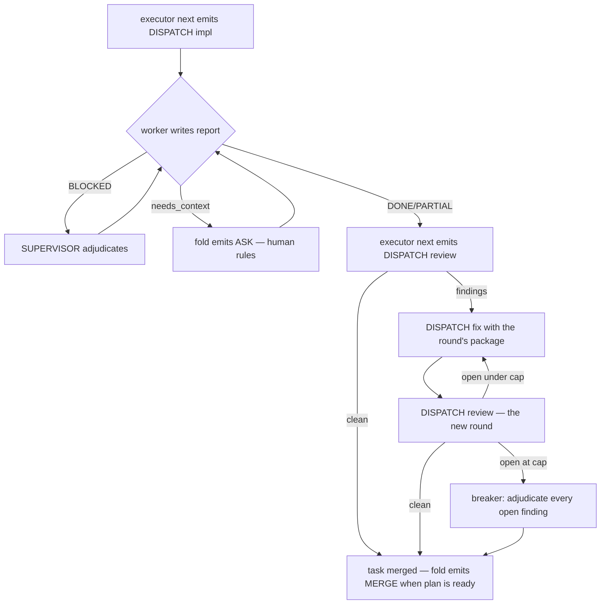

# Executor — Execution

Execute one plan by following `executor next`: the engine mints a dispatch
(`impl`, `review`, `fix`), you spawn the worker and ingest its payload.
You are the **controller**: you pump, you dispatch, you never implement.

**Why subagents.** Each task goes to an agent with isolated context whose
prompt the engine renders. It never inherits your session's history, so it
cannot be distracted by another task's decisions, and your own context
stays free for coordination — the only thing you cannot delegate.

**Core loop:** `executor next` emits `DISPATCH` → spawn the role on its
prompt → the worker writes its payload to `respond_to` → `executor ingest`
folds it → `executor next` decides again. A poll that changes nothing
emits the same action; repeated polling is free.

**Narration:** between tool calls, at most one short line. The journal and
the views carry the record.

## Prerequisites

The engine enforces all of these at `executor next` — your job is to
recognize when they hold:

| Requirement | How you know it holds |
|---|---|
| A plan exists at `plans/<PLAN-ID>/plan.json` | `executor status` names the phase `execution` |
| The planning gate passed | the fold shows `gate_decision` for `planning` |
| The plan-regression phase passed or was skipped | `phase_entered` for `execution` is journaled |
| The spec is reachable | the plan's `cites` names it |

Never hand-build a store path — every path you need arrives in the action
`executor next` emits.

## Setup

**1. Isolated workspace — detect before creating.** The branch model is
`references/branches.md` (initiative → plan → task, merged on gates). The
engine records `commit_base`/`commit_head` on verdicts and checks the
`merge` payload's `merge_sha` — the *mechanics* of forking are yours:

- A task branch forks from the **plan branch tip** at dispatch, so task
  N+1 already contains task N's merged work.
- A task branch merges back only when its verdict is clean — the engine
  won't emit `MERGE` for a plan with an open review.
- A `sequential: true` plan's tasks commit directly to the plan branch.

**2. Read the journal before anything else.** Conversation memory does
not survive compaction — controllers that lost their place have
re-dispatched entire completed task sequences, the single most expensive
failure observed. The fold, not your todos, is the recovery map:

- `executor status` — task states and counts.
- `executor doctor` — open dispatches and the policy in force.
- `executor check` — a fold disagreement, a dangling edge, a suspect
  dispatch: repair it before new work, not after.

A task whose state is `dispatched` may still be a live agent you can
resume — preserving its context — or a dead one the engine abandons past
`deadline_s`. The fold knows which.

**3. Read the plan once.** Note the plan's `tasks[]` — `goal`, `files`,
`accepts`, `depends_on` — and the spec it `cites`. The spec is the
binding authority; conflicts resolve against it.

**4. The preflight scan already ran.** The engine scans the plan's
file-ownership map at `phase_entered` and writes
`plans/<PLAN>/preflight.json` — two tasks claiming the same file is a
conflict named there. Read it; a conflict is a ruling the human records
via `executor decide`, not a dispatch.

## Model Selection

Use the **least powerful model that can handle each role**:

| Role / shape | Tier |
|---|---|
| Mechanical implementation — isolated function, complete spec, 1-2 files | cheap |
| Integration and judgment — multi-file coordination, debugging | standard |
| Architecture and design judgment, broad codebase understanding | most capable |
| Task review | scaled to the diff's size, complexity, and risk |
| Scoped re-review of a small fix diff | cheap-to-mid |
| Fix rounds near the cap | **at least one tier above the implementer that got stuck** |
| The final whole-branch audit | most capable — never the session default |

**Always specify the model explicitly when dispatching.** An omitted
model inherits your session's — usually the most capable and most
expensive — which silently defeats this entire section.

**Turn count beats token price.** The cheapest models routinely take 2-3×
the turns on multi-step work; use a mid-tier model as the floor for
reviewers and for implementers working from prose.

## Context Discipline

Everything you paste into a dispatch prompt — and everything a worker
prints back — **stays resident in your context for the rest of the
session.** Hand work over as paths, never as content:

- Never make a worker read the whole plan — its `prompt.md` carries the
  task's contract.
- Never paste prior-task history into a later dispatch. A real session's
  dispatch hit **42k characters of which 99% was pasted history**.
- Never transcribe a verdict into your own context — `respond_to` and the
  journal carry it; you read `executor status` and act on the fold.
- Review diffs never enter your context — the package carries them.

## Waiting Discipline

Never poll with short timeouts; never sit in an open-ended wait either.

- While you have local work — packaging a review, reconciling the fold —
  keep working. Worker payloads arrive on their own.
- When genuinely idle, wait in **bounded stretches** (five to ten minutes
  where the platform allows).
- Between stretches, post one line of status and reconcile live
  dispatches: `executor doctor` says which are open.

## The Task Loop

**Never dispatch multiple implementers in parallel** — they conflict in
the same worktree.

### 1. Dispatch the implementer

When `executor next` emits `DISPATCH` with `role: "impl"`:

- Spawn the implementer on the engine's rendered prompt
  (`dispatches/<D>/prompt.md` — it carries `respond_to`, the task's
  `goal`/`files`/`accepts`, and the seam `context`) prepended with
  `implementer-prompt.md`, per the prompt registry.
- Record `commit_base` — the branch tip before the worker starts; the
  review package's diff is `base..head`. Never `HEAD~1`.
- If the worker asks a question before or mid-task, answer it — the
  payload's `needs_context` path is for what it genuinely cannot
  discover.

### 2. Ingest the report

`executor ingest` accepts the `report` payload and folds it:

| `result` | The fold does | You do |
|---|---|---|
| `DONE`/`DONE_WITH_CONCERNS` | task `reported` → `DISPATCH review` | nothing — the engine routes |
| `PARTIAL` | same; the gap is in `summary` | read it; a silent scope reduction is a finding |
| `BLOCKED` | task `blocked` → `ASK`/`ESCALATE` | SUPERVISOR adjudicates; don't answer it yourself |

**The four-way assessment belongs to the SUPERVISOR:** a blocker is (1) a
context problem → more context, same model; (2) a reasoning ceiling →
more capable model; (3) a task too large → split it; (4) a plan defect →
a ruling. Dispatch it, don't answer it.

**Never force the same model to retry unchanged** — something changes
before the next attempt, or you pay for the same failure twice.

### 3. The task review

`executor next` emits `DISPATCH` with `role: "review"` and the engine has
already packaged the diff into `reviews/R<NN>.package.json`:

- Spawn the reviewer on `task-reviewer-prompt.md` + the engine brief.
- **Never pre-judge findings** — no "do not flag", "at most Minor", or
  "the plan chose" in the prompt. That is pre-judging, usually to spare
  yourself a review loop.
- The verdict payload's `round`, `commit_base`, `commit_head`, and
  `reviewed_package_sha` echo the engine's minted values — a verdict
  about another range is rejected.

**"Cannot verify from diff" items** — requirements in unchanged code or
spanning tasks — are yours to resolve: the controller holds the plan and
cross-task context the reviewer lacks. A confirmed gap is a failed
review.

### 4. The fix loop

A failed spec or any open `critical`/`important` finding enters the loop:
`fix_rounds` counts up to the policy cap (`max_fix_rounds`), and each
round is a `fix` dispatch + a `review` round.

- **`minor` findings never enter the loop** — they stay `open` in the
  journal and the final audit triages them.
- **A finding that conflicts with what the plan mandates is a ruling** —
  the human records it via `executor decide`; you never dismiss a finding
  because the plan mandates it.
- **A dispute is a ruling trigger, not a fix round** — when implementer
  and reviewer disagree about what the contract requires, the ruling
  unblocks the loop, not another round.
- **Rounds early: resume the same implementer** — the fix package
  (`fixes/R<NN>.fix-package.json`) carries the findings verbatim; the
  implementer fixes at the source, re-runs covering tests, answers the
  `report` on the new slot.
- **Rounds late: a fresh implementer one tier up** — a loop that survives
  resumes usually means the implementer cannot see its own problem.
- **Root cause, or it is not a fix** — suppressing the symptom (guarding
  one path, adding a retry, widening a type) without altering the
  condition is `open` by definition.
- **A bug-fix round is a TDD round** — the failing test that reproduces
  the defect, written first, is the regression guard.

**The breaker.** At the cap with findings still `open`, the engine emits
`ESCALATE` — adjudicate each open finding: the reviewer is wrong (park
with a ruling saying why the code stands), real but nothing downstream
builds on it (park, `routed`), or real and load-bearing (rule on the
smallest unblocking change, carry it into the next dispatch). **A silent
discard is forbidden** — every adjudication is a journaled ruling.

### 5. Complete the task

The verdict folds clean → the task merges (its branch merges to the plan
branch) → `executor next` moves to the next task or, when the plan's
tasks all merge, emits `MERGE` for the plan.

**Never move to the next task while a review has open `critical`/
`important` findings that are neither fixed nor parked-with-ruling at
the cap.**

## The final whole-branch audit

`executor next` emits a plan-level `DISPATCH` with `role: "audit"` —
`final-reviewer-prompt.md`, most capable model. It judges the branch as
one change: cross-task coherence, spec compliance end to end, every
deferred minor and `routed` finding triaged. A `FAIL` enters the plan's
fix wave — **one** fix dispatch with the complete findings list, not one
per finding, then one re-audit.

## Finish

1. `executor check --secrets` — exit 0 over both stores; resolve every
   finding per `references/safety.md`.
2. `executor status` — the run's state agrees with what you saw.
3. **The workspace is never deleted** — the reports and verdicts are the
   reasoning record.
4. Route to `executor-verification`, then `executor-handoff`.

## The Citation Rule

Every payload you touch lives inside `INIT-0004` and **must not cite an ID
from another initiative.** State the requirement in your own words — the
dependency belongs in the charter's `cites`, the only place a
cross-initiative ID may appear.

## Self-Critique

Before routing onward, attack the run:

1. Did every task merge only on a clean verdict?
2. Was every dispatch briefed from its registered template, every
   placeholder filled and the model named?
3. Is every ruling journaled — and every decision-class question asked
   on the spot, not batched into a gate?
4. Did any implementer's `DONE` stand in for its review?
5. Did any task touch files outside its `files`?

## Verification

1. `executor status` — phase `execution`, every task `merged` or
   accounted for.
2. `executor doctor` — no open dispatches you did not mean to leave.
3. `executor check` — fold clean, no dangling edges, no suspect
   dispatches.
4. `executor check --secrets` — exit 0.

## Common Rationalizations

| Excuse | Reality |
|---|---|
| "Close enough on spec compliance" | Reviewer found gaps = not done. Fix, or hit the cap and adjudicate — those are the only exits. |
| "I'll fix it myself, dispatching is overhead" | Controller fixes pollute your context and skip review entirely. Resume the implementer. |
| "One more round will converge" | Past the cap, rounds don't converge — the failure is structural. `ESCALATE` is the answer, not another round. |
| "This finding is obviously wrong, I'll drop it" | You adjudicate only at the cap, and every adjudication is a recorded ruling. Silent discards are forbidden. |
| "The fix was small, skip the re-review" | Unreviewed fixes are how regressions land. Every round ends with a scoped re-review. |
| "The engine keeps re-emitting DISPATCH" | A poll that changes nothing is free — it is telling you a slot is still open, not asking twice. |
| "I'll poll until it does something" | `executor next` emits the same action until an event moves the fold; ingest the payload, then poll. |
| "The model field is optional" | The default is your session's model — usually the most expensive. |
| "The plan says to do it, so the finding is invalid" | The spec is the binding authority; the plan is its argument. Rule on the conflict, don't dismiss the finding. |
| "The secret is only in a git-ignored file" | `check --secrets` scans both stores; a secret in a diff is also in git history. |
| "The implementer patched the symptom" | A symptom fix is `open` by definition — the fix report must name the root cause. |
| "TDD is the implementer's choice" | The Iron Law binds every task that changes behavior; a GREEN-only report is a spec-compliance finding. |
