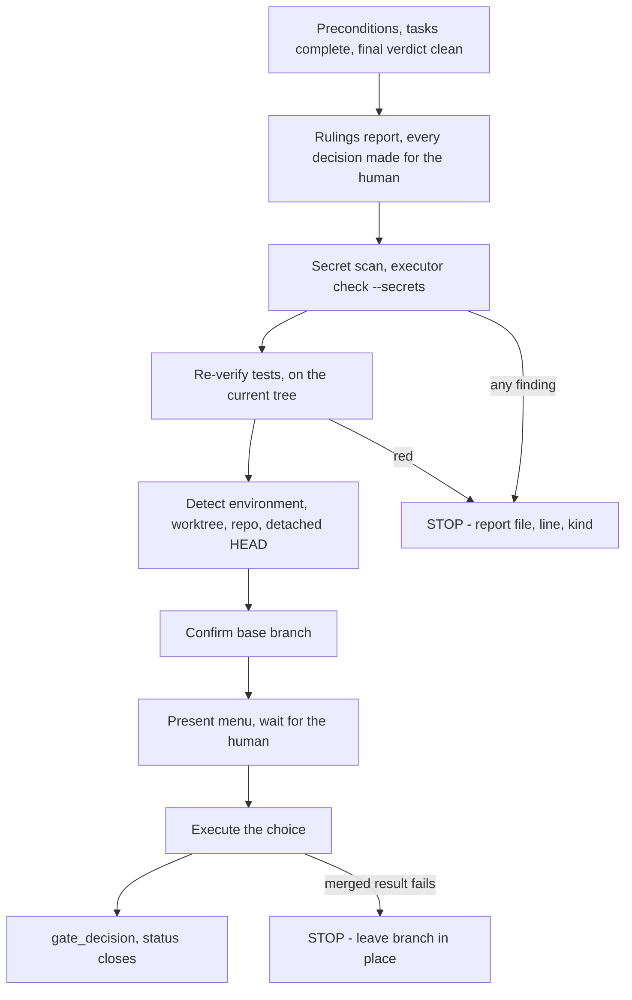

# Executor Handoff

> **Engine.** `executor <verb>` means
> `python3 <skills-dir>/executor/scripts/executor <verb>`; the engine ships
> inside the router skill, so nothing is on `PATH`.

Close-out is the phase where the human learns what you decided for
them, where a leaked credential is caught before it becomes permanent,
and where the journal stops being a working log and becomes the
archive. It is also where a session that ran out of room hands the
initiative to the next one.

**Nothing in either store is ever deleted by this skill.**

## The gate order

Each gate blocks the next. Do not reorder — the secret scan is
worthless after a push, and the menu is dishonest before a green run.



## Step 0 — Preconditions

Handoff starts only when `executor status` shows all of these. If one
does not, you are still in an earlier phase; go back to its skill.

| Precondition | Where you check it |
|---|---|
| Every task in every plan reached a verdict | `executor status` — no task left `dispatched` or `pending` |
| Every task has a clean or accepted `verdict` | the journal's `verdict` payloads — a `fix_needed` left open is unfinished work |
| Verification produced observed evidence, not expectation | the `evidence` payloads' `observed` fields |
| Every `failed`/unanswered/`unavailable` criterion has an explicit human acceptance | a `gate_decision` note or `ruling` naming the criterion and the residual risk — an acceptance the human never made does not exist |
| The store is consistent | `executor check` — exit 0 required |
| The journal exports cleanly | `executor doctor` — no finding |

Run before anything else in this phase:

```bash
executor check
```

The `PHASE-ENTER handoff` event is the entry record — the journal
remembers it, so an interrupted handoff is visible to the next session.

## Step 1 — The rulings report

Every decision you took on the human's behalf reaches them here. This
is the whole point of being allowed to rule instead of stall: they get
one readable list, and they rework whatever you got wrong. A ruling
they never saw is a decision made in secret.

The `ruling` payloads are in the journal — durable — but the report is
for the human sitting in front of you, who will not open a file they
were not told exists.

### Collect

1. Walk the journal's `ruling` events — `views/progress.md` renders
   them in order, which is the order they were made. Each carries
   `decision`, `why`, `cost_if_wrong`, and `for_task`/`for_plan` where
   it applied.
2. Any pre-dispatch adjudication (a task paused for a file conflict,
   a `spawn_error` retried) must have a ruling. Anything there with no
   `ruling` payload is a gap.
3. Verdict findings marked parked, deferred, or won't-fix must each
   have a ruling.
4. **Close gaps before reporting, not after:**

```bash
executor decide - <<'JSON'
{"kind": "ruling", "v": "v1", "for_task": "INIT-0004-P01-T05",
 "decision": "…", "why": "…", "cost_if_wrong": "…"}
JSON
```

Do not backfill a ruling into the report only — it is a journal
payload, not a paragraph.

### Report

In the final message, under a heading exactly `Rulings I made`, in the
order they were made, grouped by plan when the initiative has more
than one:

```markdown
## Rulings I made

1. **INIT-0004-P01-T03** — Kept the existing retry cap at 3 instead of the
   plan's 5. Why: task 7 asserts 3 in its acceptance test and the plan
   contradicted itself. Cost if wrong: one-line change plus a test edit.
2. **preflight** — Task 4 and task 6 both touch `router.ts`; ran them
   sequentially rather than splitting the file. Cost if wrong: a slower
   run, no correctness impact.

The payloads are in the journal — `views/progress.md` lists them.
```

Do not compress a ruling into its decision alone. **Cost if wrong is
the field the human triages on** — without it they must reconstruct
the stakes of every line.

**Empty case.** Zero rulings is a legitimate outcome and is still
reported:

```markdown
## Rulings I made

None. Every decision on this initiative was yours.
```

Before writing that, confirm it: an execution with fix rounds, parked
findings, or task conflicts and an empty `ruling` set means rulings
were made and never written. Reconstruct them from the verdicts and
the dispatches, record them via `executor decide`, then report.

## Step 2 — The secret scan gate

```bash
executor check --secrets
```

Exit 0 and handoff proceeds. Findings print one `file:line` and the
rule name per hit and **block handoff**. The check never prints the
matched value, and neither do you — printing it copies the secret
into the transcript, which is the failure the scan exists to prevent.

On any finding, follow `../executor/references/safety.md`:

| Situation | Action |
|---|---|
| Any finding at all | Tell the human immediately: which file, which line, what kind. Nothing else moves. |
| Only in the untracked store, never committed | That file is the only copy. The human chooses redact-in-place or discard the artifact. |
| Reached git | This is credential rotation, not a file edit. The human rotates. |
| History rewriting | Never yours. Never unasked. Not even when it looks trivial. |
| After resolution | Record the incident as a `ruling` — kind of credential, which artifact, what was done. Never the value. |

A finding inside the committed docs store or a diff an `evidence`
payload captured means the secret is in git history too. Say so
explicitly; it changes the human's response from "edit a file" to
"rotate a credential".

Re-run the scan after any redaction. A scan is evidence for the tree
it ran on, same as a test run.

## Step 3 — Verify before the menu

Run the project's full suite (`npm test` / `cargo test` / `pytest` /
`go test ./...` — whatever this repo uses) **on the current tree**,
now.

A green run only proves the tree it ran on. The verification phase's
evidence was gathered before the last fix round, before the last
review finding landed, possibly before a rebase. It does not
transfer.

If the suite is red: report the failures and stop. The menu comes
after a green suite — offering integration options on a red tree asks
the human to approve something you know is broken.

Record the command and its observed outcome; it becomes the evidence
line in the final message. Never write an expected result as an
observed one.

**Full-suite scope:** run the suite that covers the changed surface.
For a docs-only initiative the "suite" is `executor check` plus any
documented render/lint checks — a test runner that would exercise
nothing is not required to run for ceremony. The verification phase's
capability map already recorded what evidence was feasible; handoff
re-runs what is feasible now, on the current tree. A required check
that exists but fails still blocks.

## Step 4 — Detect environment

```bash
GIT_DIR=$(cd "$(git rev-parse --git-dir)" 2>/dev/null && pwd -P)
GIT_COMMON=$(cd "$(git rev-parse --git-common-dir)" 2>/dev/null && pwd -P)
# Capture now, while still inside the workspace — Step 7 changes directory
# before worktree handling needs this value
WORKTREE_PATH=$(git rev-parse --show-toplevel)
```

| State | Menu | Workspace |
|---|---|---|
| `GIT_DIR == GIT_COMMON` (normal repo) | Standard 3 options | No worktree to handle |
| `GIT_DIR != GIT_COMMON`, named branch | Standard 3 options | Provenance-based (§7) |
| `GIT_DIR != GIT_COMMON`, detached HEAD | Reduced 2 options (no merge) | Externally managed — leave in place |

**Executor-specific:** the two stores resolve from two different roots.
`docs/executor/` is committed with the working tree, so artifacts travel
with the merge. `.executor/` is the run store — local state, not
committed — so a worktree removal cannot destroy the journal the
initiative lives in.

## Step 5 — Determine base branch

For an Executor initiative this is already recorded: the initiative's
meta names the branch it ran on. For non-Executor work the base is
whatever this work forked from — usually named in the charter, the
plan, the conversation, or the branch's upstream. If it is not already
known, ask:

```
This branch split from <your best guess> — is that correct?
```

Confirm before merging. "The base branch is obviously main" is the
classic wrong merge, and merging into the wrong base is expensive to
undo.

## Step 6 — Present options

**Normal repo and named-branch worktree — exactly these 3:**

```
Implementation complete. What would you like to do?

1. Merge back to <base-branch> locally
2. Push and create a Pull Request
3. Keep the branch as-is (I'll handle it later)

Which option?
```

**Executor initiative completion.** Task dispatches have already
closed — each merge decision was the `MERGE` action gated on the
plan's verdicts. This menu is for the initiative's integration itself:
merging it onward is the human's explicit decision, taken here, with
the verification outcomes in front of them.

Before presenting the menu, one last check:

```bash
executor check
```

Exit 0 — any dangling edge or unverifiable ref is fixed before the
human is asked to merge.

**Detached HEAD — exactly these 2:**

```
Implementation complete. You're on a detached HEAD (externally managed workspace).

1. Push as new branch and create a Pull Request
2. Keep as-is (I'll handle it later)

Which option?
```

Present the menu as written, and **end your turn with the menu on
screen**. Do not add a discard option — discarding happens only when
the human asks for it in so many words (§7). Do not pre-select an
option, do not begin any option's work, and do not run Step 8 in the
same message. Wait for the answer; the integration decision is theirs.

## Step 7 — Execute the choice

### Git discipline (applies to every path below)

| Rule | Why |
|---|---|
| Never commit to a protected default branch | `main` stays deployable; branch first, always |
| Conventional Commits, imperative, ≤72 chars | `feat(router): add cell placement scoring` |
| Review `git diff --cached` before every commit | Last chance to catch a secret or a generated artifact |
| Never stage `.executor/` | It is ignored by design; committing it makes it public surface (see safety.md) |
| Squash a feature branch into clean history | A trail of `wip` commits is not a record; the journal is |
| Force-push only on explicit request | A rejected push means the remote moved — investigate first |

### Option 1: merge locally

```bash
MAIN_ROOT=$(git -C "$(git rev-parse --git-common-dir)/.." rev-parse --show-toplevel)
cd "$MAIN_ROOT"

git checkout <base-branch>
git pull
git merge <feature-branch>

<test command>          # verify on the merged result
```

**If tests fail on the merged result: stop everything.** Leave the
branch and the worktree in place and investigate. Nothing has been
pushed, so the merge is local and recoverable. A failing merged
result is never flaky until proven flaky.

Once green, delete the feature branch only after the worktree step
below:

```bash
git branch -d <feature-branch>
```

### Worktree handling (Option 1 and confirmed discards only)

Options 2 and 3 always preserve the worktree — PR feedback gets fixed
there.

**The run store survives this.** `.executor/` lives at the repository
root, not in the worktree, so worktree removal cannot destroy an
execution record. Never copy the store anywhere — a second copy is
two divergent records where the contract guarantees one.

1. **If `GIT_DIR == GIT_COMMON`:** normal repo, nothing to do.
2. **If `WORKTREE_PATH` is under `.worktrees/` or `worktrees/`:** we
   own it.

```bash
git worktree remove "$WORKTREE_PATH"
git worktree prune
```

3. **If removal is refused** (`contains modified or untracked files`):
   those files exist nowhere else. Never `--force` on your own
   initiative. Show what is at stake and ask:

```bash
git -C "$WORKTREE_PATH" status --porcelain -uall
```

```
Worktree removal refused — these files were never committed:

<file list>

1. Commit them to <branch> before cleanup
2. Move them into <main repo root>
3. Delete them (unrecoverable)

Which?
```

4. **Otherwise:** the host environment owns this workspace. Leave it.
   Clean up only worktrees under `.worktrees/` or `worktrees/`.

### Option 2: push and create a PR

```bash
git push -u origin <feature-branch>
# From a detached HEAD, name the branch on the remote:
# git push origin HEAD:refs/heads/<new-branch>
```

Create the pull request against `<base-branch>` with the forge's
tooling — its CLI if available, or the creation URL most forges print
on push — following the repo's PR template if one exists. Report the
URL.

The PR description links the initiative: its docs folder, the charter,
the spec, and the verdicts. Keep the worktree.

### Option 3: keep as-is

Report: `Keeping branch <name>. Worktree preserved at <path>.` Then
still run Step 8 — the lifecycle closes regardless of integration
choice, because the work is done even if it has not landed.

### If the human asks to discard the work

Only ever a response to an explicit request. Confirm first:

```
This will permanently delete:
- Branch <name>
- All commits: <commit-list>
- Worktree at <path>

Type 'discard' to confirm.
```

Wait for that exact word. "Yeah, get rid of it" is not it. On
confirmation: remove the worktree (the run store is at the main root
and stays — the record of a discarded attempt is often the most
valuable thing it produced), then:

```bash
git branch -D <feature-branch>
```

The initiative is abandoned, not complete — a `ruling` plus a `halt`
records why.

### Quick reference

| Option | Merge | Push | Keep worktree | Delete branch |
|---|---|---|---|---|
| 1. Merge locally | yes | — | — | yes (`-d`) |
| 2. Create PR | — | yes | yes | — |
| 3. Keep as-is | — | — | yes | — |
| Discard (explicit request only) | — | — | — | yes (`-D`) |

## Step 8 — Lifecycle closure

The `GATE handoff` is the human's sign-off — the engine emits it after
the journal exports, and a `gate_decision` `approved` sets the fold's
`done`. The human records it:

```bash
executor decide - <<'JSON'
{"kind": "gate_decision", "v": "v1", "phase": "handoff",
 "decision": "approved", "by": "human",
 "note": "merged to main, PR #482"}
JSON
```

`done` is what finishes the initiative: `find_initiative` stops
treating it as active, and the exported docs store is the archive.

### Nothing is deleted — deliberately

The legacy workflow deleted the plan's workspace when the plan
finished. **The Executor reverses that on purpose.** The store holds
the dispatches, the payloads, the verdicts, and the rulings — the
only surviving answer to "why is this code like this". Deleting it
destroyed the reasoning and kept the artifact, which is exactly
backwards.

So: a complete initiative's store stays. The journal stays. The
exported documents stay. Pruning either is a deliberate human
decision, taken with intent, never a cleanup step at the end of a
task.

This is not in tension with workspace hygiene. Scratch files you
created outside the two stores — probe scripts, temp diffs, `/tmp`
artifacts — are still yours to remove. The stores are the
deliverable.

## Step 9 — The final message

Structure, in this order:

1. **What shipped** — one paragraph, initiative ID and title.
2. **Rulings I made** — §1, mandatory, empty case included.
3. **Evidence** — the exact test command and its observed outcome;
   the secret-scan result; the verdicts.
4. **What changed in git** — branch, base, merge or PR URL, commit
   count.
5. **Where the record lives** — the initiative's docs dir, the run
   store.
6. **What was not done** — deferred findings, accepted risks,
   follow-ups. Named here or they are lost.

Every claim traces to something you observed. An unrun check is
reported as unrun, not omitted.

## Partial handoff — pausing an initiative

An initiative usually outlives a session. Pausing is a first-class
outcome, not a failure, and it is **not** abandonment:

| State | Meaning | Resumable |
|---|---|---|
| `halt` (latched) | Suspended deliberately — a `halt` payload or a `rejected` gate decision | Yes — a human `resume` payload unlatches it |
| abandoned | Stopped on purpose; the work is no longer wanted | No — a `ruling` says why |
| `done` | The handoff gate approved | Terminal |

### What to write before stopping

1. **Rulings** — every decision made this session is a `ruling`
   payload via `executor decide`. Write them now; a ruling
   reconstructed next session is a guess.
2. **Secret scan** — run it anyway. A paused store is still a store,
   and the pause may last months.
3. **The `halt`** — the human (or the fold, on a rejected gate)
   latches it; `executor status` shows `halt` until `resume`.
4. **Session record** — a `.local/handoff/session/` record per
   `local-context-tracking`: numbered `NNNN-YYYYMMDDTHHMMSSZ-topic.md`,
   full frontmatter, plus branch, HEAD, `git status --short`, the
   continuation verdict, and the resume commands. It points at the
   initiative; it does not duplicate it.

Uncommitted work is committed on the feature branch before pausing,
or named explicitly in the session record as uncommitted. Work that
exists only in a dirty worktree is work that a machine reboot
deletes.

## Cross-session resume protocol

Read in this order. Each step narrows the next; skipping ahead is how
a resumed session re-derives state it already had.

| # | Read | What it tells you |
|---|---|---|
| 1 | `.executor/` — the initiative dirs | Which initiatives exist |
| 2 | `executor status` | Phase, tasks, artifacts, critiques — **where work stopped** |
| 3 | `views/progress.md` | Tasks done, tasks mid-flight, rulings so far |
| 4 | `views/dispatches.md` | Whether a live dispatch can be revived instead of re-dispatched |
| 5 | `views/summary.md` | The phase narrative |
| 6 | `.local/handoff/session/` (highest sequence, not superseded) | The previous session's continuation verdict |

Then verify the world, before planning or editing anything:

```bash
git branch --show-current
git rev-parse HEAD
git status --short
executor status
```

**Precedence, absolute:** current user instruction beats current
repository state beats stored records. If `progress.md` says task 5
is complete and the code says otherwise, the code wins — and you
write a correction record rather than editing the old one, per
`local-context-tracking`'s append-only rule.

**A missing store is a verified absence, not permission to invent
prior context.** No `.executor/<INIT>/` means that initiative never
ran. No `.local/` means no session record exists. Neither means
"assume what probably happened" — it means say what you found and
start from repository truth.

Re-read every binding payload the record names — the charter, the
spec, the `ifce`s — before touching code. A summary of a spec is not
a spec.

## Self-Critique

Before presenting the options menu, and again before the final
message:

1. **Does the rulings report list every `ruling` payload**, including
   the ones the human answered as questions? Count them against the
   journal.
2. **Was the test suite run on the exact tree being integrated**, not
   an earlier commit?
3. **Is every unanswered criterion stated to the human** as an open
   gap rather than folded into "verified"?
4. **After a merge, did you offer stale-branch cleanup** — candidates
   listed from `git branch --merged` and `git ls-remote`, deletion
   only on approval?
5. **Does the final message claim only what this session observed**,
   with everything else marked as inference?

## Verification

Run these in this session and cite their output in the final message:

1. `executor check --secrets` — exit 0 (Step 2's gate).
2. The project's test suite on the integration tree — exit 0
   (Step 3).
3. `executor check` — no finding for this initiative.
4. After a merge: `git branch --merged <integration>` and
   `git ls-remote --heads origin` — the cleanup candidate list.

## Common rationalizations

| Excuse | Reality |
|---|---|
| "Tests passed earlier this session" | Run the suite on the tree you are about to integrate. A green run only proves the tree it ran on. |
| "The rulings are in the journal, that's the record" | It is the durable record. The report is how the human learns the decisions exist. Both, always. |
| "Only two small rulings, not worth a section" | Small rulings are the ones that ship wrong and nobody notices. Report all of them, with cost-if-wrong. |
| "No rulings, so no section" | Write the empty case explicitly. Silence reads as an omission, not as zero. |
| "No secrets in this one, skipping the scan" | The scan is seconds and the failure is unrecoverable once pushed. Run it. |
| "I'll show the human the matched line so they can find it" | File, line, and kind. Printing the value copies the secret into the transcript. |
| "The secret is only in a diff, not the source" | A diff captured a commit. It is in git history too. Say that — it changes rotation from optional to required. |
| "They obviously want it merged" | Integration is the human's decision. Present the menu and wait. |
| "The base branch is obviously main" | Confirm the fork point or ask. Merging into the wrong base is expensive to undo. |
| "They seem done with this — I'll offer to discard it" | The menu is complete as written. Discard happens only when they ask for it in so many words. |
| "'Yeah, get rid of it' counts as confirmation" | Only the typed word `discard` authorizes deletion. |
| "The merged-result failure is probably flaky" | A failing merged result stops everything. Branch and worktree stay put while you investigate. |
| "The push was rejected — force-push will fix it" | The remote moved. Investigate. Force-push only on explicit request. |
| "The PR is up, so the worktree is clutter now" | PR feedback gets fixed in that worktree. It stays until the work lands. |
| "This other worktree looks stale — I'll clean it too" | Only `.worktrees/` and `worktrees/`. Everything else belongs to the host. |
| "Removal refused — `--force` finishes the cleanup" | The refusal means files exist only there. Show the human and ask. |
| "The plan is done, so the store is scratch" | The store is the reasoning. It closes; it is never deleted. |
| "I'll copy `.executor/` out before removing the worktree" | It already lives at the repo root. A copy is two divergent records. Remove the worktree; the store stays. |
| "Paused and abandoned are close enough" | One says pick this up, the other says do not. That is the whole value of the distinction. |
| "The view says task 5 is done, so it is" | The checkout wins over any record. Verify, then write a correction. |
| "No `.local/` record, so I'll reconstruct what probably happened" | A missing record is a verified absence. Report it and start from repository truth. |
