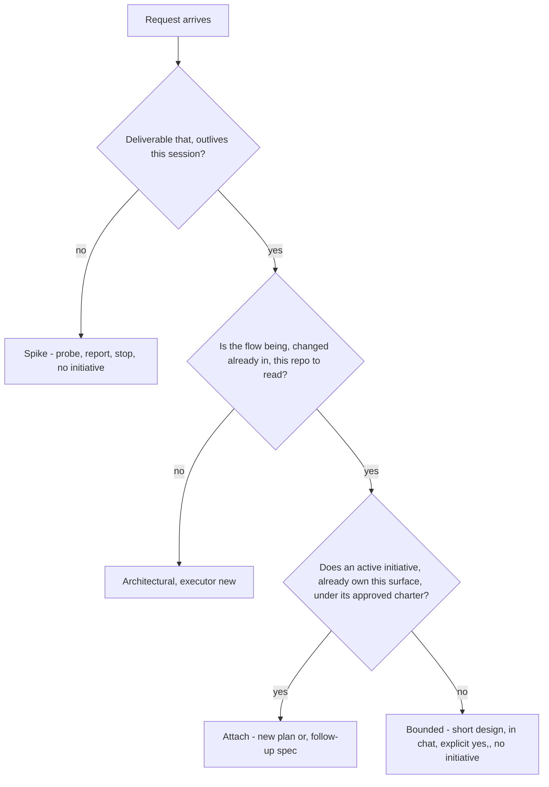

# Executor — Initiative Intake and Lifecycle

Read [the contract](../executor/SKILL.md) first: ID grammar, the citation
rule, the phase table, the pump contract. This skill is the only thing
that allocates initiative numbers and owns intake judgment.

Two duties, in order:

1. **Decide whether an initiative should exist at all.** Most requests do
   not get one. Creating one for trivial work is this system's primary
   failure mode — the ceremony becomes the work.
2. **If it should exist, run `executor new`**, then follow the pump: the
   `intake` phase wants a `charter` artifact, an audit, and a human gate.

## 1. The Initiative Gate

**The one-line test:** name the deliverable that outlives this session. If
you cannot, there is no initiative — answer the question and stop.

Classify the request into one of three paths **before your first
clarifying question**, and say the classification out loud so the human
can override it:

> "This looks bounded — the retry flow is already in `client/http.ts`, so
> I'll present a short design here rather than open an initiative."

| Path | Signal | Output | Initiative? |
|---|---|---|---|
| **Spike** | A feasibility question — "can we", "is it possible", "quick and dirty is fine" | An answer, not code you keep | **Never.** Present the question and probe in 2–3 sentences, get a nod, investigate as cheaply as correctness allows, report a recommendation. Anything built stays labeled throwaway. |
| **Bounded** | A well-scoped change to a flow **that already exists in this repo** — a flag, a small endpoint, a one-file fix | A commit | **Usually not.** Ask the questions that matter, present a short design in chat, stop for an explicit yes, implement. Attach to an existing initiative only if one already owns that surface (§4). |
| **Architectural** | New project, new subsystem, restructures how components fit, or alters an interface others depend on | A body of work spanning sessions | **Always.** Allocate, charter, gate (§2, §3). |

**Bounded measures the repo, not your familiarity.** Understanding the
kind of app is not enough — bounded means the flow you are changing is
here to read. A new project has no existing flow, so it is architectural,
so it gets an initiative. This is the single most common
misclassification.

**When in doubt between two paths, take the heavier one.** The doubt is
the signal.

**The ratchet is one-way.** Hidden complexity discovered mid-task upgrades
the path: stop, say so, and step up — a bounded change that turns out to
touch three components becomes architectural mid-flight, and the
initiative is opened *now*, with what already happened recorded in the
charter's Problem section. Nothing ever downgrades. An architectural task
does not become bounded because you are tired of it.

**Approval never scales.** Every path ends with the human approving your
intent before implementation. A spike's approval is a nod; an
initiative's is the intake gate. What scales with simplicity is the
artifact, never the gate.



### Red flags

| Thought | Reality |
|---|---|
| "This is too simple to need an initiative" | Simple means a short design and a fast yes, not a skipped gate. If it produces a lasting deliverable it gets an initiative with three short documents. |
| "I'll call it bounded and skip the charter" | Reaching for a label to skip work IS the doubt. Take the heavier path. |
| "I understand this kind of app, so it's bounded" | Bounded measures the repo, not your familiarity. A new project has no existing flow — it is architectural. |
| "The design is obvious, I'll scaffold while they read the charter" | The gate is the approval, not the charter's length. Present, then stop until you hear yes. |
| "The spike works, so I'll keep the code" | A spike's output is an answer. Keeping the code is a new request — classify it from scratch. |
| "It grew, but I'm almost done — no need to re-classify" | Hidden complexity upgrades the path mid-task. Stop, say so, open the initiative, and record what already happened. |
| "They approved the spike, so the follow-up is approved" | Each request gets its own classification and its own approval. |
| "I'll open an initiative to be safe" | Nothing deletes an initiative. An initiative whose deliverable you cannot name is permanent ceremony. |
| "Two related asks, one initiative — saves ceremony" | One initiative, one problem statement, one set of success criteria. Two problems in one charter means no gate can ever be evaluated. |

## 2. Allocation

Allocate only after the classification says architectural (or the human
explicitly asks for an initiative):

```bash
executor new "Cloud tenant cells"
# -> {"created": "INIT-0004", "store": ".../.executor/INIT-0004",
#     "docs": ".../docs/executor/INIT-0004"}
```

`new` does all of this in one call — never hand-build any of it:

| Created | Detail |
|---|---|
| Run store | `.executor/INIT-<NNNN>/` — journal, meta, autonomy policy, dispatch dirs |
| Meta | `meta/meta.json` with the engine, schema, and store versions |
| Docs dir | `docs/executor/INIT-<NNNN>/` — the tracked thinking store's home |
| Journal | A `created` event — the first entry everything else follows |

**The race rule.** `new` scans `.executor/` for existing `INIT-*` dirs and
takes the next number. `init_store` refuses to re-scaffold an existing
dir, so two simultaneous `new` calls can collide only on the number itself.
On a collision the folder without a journaled `created` event renumbers —
never overwrite and never delete, and record the race in a `ruling` on the
surviving initiative.

**One active initiative per repo.** `find_initiative` refuses
(`ambiguous`) when two initiatives are unfinished; the second one's work
must wait, or the first must reach its handoff gate. Commands take an
explicit `INIT` argument when you truly mean a non-active one.

### Adopting a pre-initiative design session

When the idea was already designed before the initiative existed, intake
adopts it — the charter is derived from its brief, not re-interviewed.
The session lands as the `brainstorm` artifact when the author dispatch
runs; the charter's `cites` can name it once it exists. Where the charter
must differ from the session's brief, say what changed and why — the
human approves both.

## 3. The Charter

The charter is the artifact the human approves to pass the intake gate.
It is not a summary of the request — it is the contract that every later
phase argues from, and the only place scope is bounded.

`executor next` emits `DISPATCH` with `role: "author"`,
`schema: "charter"`, `entity: INIT-NNNN-CHTR-01`. The author writes the
payload to `respond_to`; `executor ingest` validates and journals it. The
`sections` are the charter's sections — write them in this order:

```text
Problem | Why now | Goals | Non-goals | Success criteria |
Scope boundaries | Constraints | Stakeholders | Skipped phases
```

| Section | What it must contain | Failure it prevents |
|---|---|---|
| **Problem** | What is wrong today, stated so someone outside the team recognises it, with the observed evidence (a measurement, an incident, a user report). Not a solution in disguise — "we need a queue" is not a problem. | An initiative that ships something nobody needed. |
| **Why now** | What changed to make this urgent, or what breaks if it waits. If nothing changed and nothing breaks, say so — that is a legitimate answer and it usually means the initiative can wait. | Work that displaces more urgent work because nobody asked when. |
| **Goals** | 2–5 outcomes, each one a change in the world, not an activity. "Tenants are placed in cells without manual assignment," not "write a placement service." | A goal list that a completed initiative can satisfy without helping anyone. |
| **Non-goals** | The things a reader would reasonably assume are included and are not — named explicitly. Every non-goal is a question you will otherwise answer three times during execution. | Scope creep arriving as "obviously this was in scope." |
| **Success criteria** | **Observable and measurable.** "Faster" is not a criterion; "p99 placement latency under 200ms at 10k tenants, measured by the existing load harness" is. Each criterion names the observation and how it gets observed, because `executor-verification` will be asked to produce exactly that evidence. | An initiative that can never be declared done, or is declared done on vibes. |
| **Scope boundaries** | Which components, directories, services, and data the work may touch — and which it may not. Name paths where you can. | Tasks that wander into unrelated subsystems and reviews that cannot tell whether that was intended. |
| **Constraints** | Hard limits that shape every later decision: compatibility guarantees, deadlines, budget, runtimes, languages, dependency policy, compliance requirements, teams whose approval is required. Redact secrets — write the shape and the source, never the value. | Architecture that is elegant and impossible. |
| **Stakeholders** | Who approves phase gates, who must be consulted, who is affected. One named approver minimum — "the team" cannot approve a charter. | A gate nobody can pass. |
| **Skipped phases** | One line per skipped phase, each with its reason. Written at the moment the decision is made, not retroactively. | A reader unable to distinguish "we considered alternatives and picked one" from "nobody looked." |

**Success criteria are the highest-leverage section.** Write them so that
a stranger with repo access could run the observation and get a yes or
no. Every downstream skill inherits their precision, or their vagueness.

**Redaction applies here.** Problem statements love to quote error logs,
and error logs contain connection strings and bearer headers. Write the
redacted existence statement and the safe path instead — see
[safety.md](../executor/references/safety.md). The payload is durable
and exported at handoff.

### The intake gate

The engine audits the charter first — an `audit` dispatch verdicts it
against the `executor-critique` catalog. When it clears, `executor next`
emits `GATE intake`: present `executor status` (the charter summary, the
audit record, the success criteria) and **stop**. Do not start discovery
until the human has approved the problem statement and the success
criteria — those two are what they are actually approving; the rest is
context. Charter approval is the first and most load-bearing gate in the
system: everything downstream argues from it, so working past it
unapproved poisons the whole initiative.

The human answers:

```bash
executor decide - <<'JSON'
{"kind": "gate_decision", "v": "v1", "phase": "intake",
 "decision": "approved", "by": "human", "note": "charter approved"}
JSON
```

A `rejected` decision halts the initiative — the engine latches `halt`
until a `resume` payload. Nothing deletes the store: the reasoning is why
anyone would ever read it.

Nothing here is a ruling. Rulings are runtime decisions recorded through
`executor decide`; intake decisions with the human in the loop are
charter content; later ones are `adr` artifacts.

## 4. Attaching to an Existing Initiative

Prefer attaching over allocating. A second problem statement is a second
initiative — a second plan is not.

**Attach when all of these hold:**

- The existing charter's Problem still describes this work.
- The existing success criteria still govern it — no new criterion is
  needed.
- The initiative is not finished (`executor status` shows a phase short
  of `handoff`, and no latched `halt`).

**Allocate a new initiative when any of these hold:**

- The success criteria would have to change or grow.
- You would have to edit the approved charter's Goals, Non-goals, or
  Scope boundaries to make the work fit. **Widening an approved charter
  silently invalidates the approval it carries** — that is the whole
  reason the gate exists.
- The initiative is `done`, halted with no resume, or superseded.

**How to attach:**

1. `executor status INIT-NNNN` — ground yourself in its phase.
2. Route the new artifact need to its owning phase: a follow-up spec to
   `executor-spec` (the spec redrafts — its `cites` name the addition), a
   second plan to `executor-planning`. This skill does not write specs
   or plans.
3. If the initiative is `halt`ed, a human `resume` payload unlatches it
   first — a pause is a decision the human makes, not a state you
   inherit.

**A second plan while the first is executing:** leave the running plan's
lane alone. `P02` is authored in `planning` like the first; the fold
carries both plans' tasks. Two plans against one spec is a planning
decision, not an intake one — say so and route it.

## 5. Phase Transitions

You do not write phase transitions — the journal does. `executor next`
emits `PHASE-ENTER` when the previous gate passed; the fold records the
phase state; `executor status` renders it. What you do at a boundary:

1. `executor status` — the gate card for the closing phase.
2. The human's `gate_decision` via `executor decide` — `approved`,
   `rejected` (halts), or `waived` with a `note`.
3. `executor next` — the emitted `PHASE-ENTER` is the transition; route
   to that phase's owning skill.

**A skipped phase is a `waived` gate_decision with a note,** recorded by
the human — never an omission. The note is the reason; a waiver with no
reason is indistinguishable from nobody looking.

**Rework does not rewind the phase.** Review findings and verification
gaps send work back through dispatches; the phase stays where the
initiative genuinely is and the journal records the loop.

## 6. Lifecycle States

| State | How it lands | How it leaves |
|---|---|---|
| active | `executor new` journals `created`; the initiative is unfinished | handoff `gate_decision` `approved` |
| paused | A `halt` payload via `executor decide` (or a `gate_decision rejected`) latches `halt` | A human `resume` payload via `executor decide` — the only thing `executor ingest` accepts while halted, besides `ruling` |
| complete | The handoff gate's `approved` decision — the fold sets `done` | Terminal |
| abandoned | A deliberate stop: a `ruling` recording why, then the `halt` that sticks | Never deleted; the reasoning is why anyone reads it |
| superseded | Another initiative replaces this one wholesale — recorded on both charters (`supersedes_initiative` / `superseded_by_initiative` in `cites`-adjacent prose) plus a `ruling` on each | Terminal |

**Nothing is ever deleted.** Not a store, not a payload, not a journal
line. Pruning is a deliberate human decision, never a cleanup step.

### Superseding an initiative

Wholesale replacement, both sides recorded:

**New initiative** — its charter `cites` the predecessor's charter ID,
and a `ruling` on the old initiative records the hand-off.

**Old initiative** — mark it `superseded` via a `ruling` + `halt`.
Documents stay readable. **Do not edit them to point at the new
initiative** — that would be a cross-initiative citation, which the
citation rule forbids.

**Why the old initiative stays readable:** its research, options, and
ADRs are the reasons the replacement exists. An unreadable predecessor
guarantees the successor re-derives its dead ends.

## 7. Index Duty

`views/summary.md` and the exported `docs/executor/INIT-NNNN/` index are
rendered by the engine — never hand-edit them. The one table that is
still yours: nothing. If `executor status` and the artifacts disagree,
the artifact payload is the truth; the view re-renders on the next event.

## 8. Cold-Start Checklist

**A request arrives:**

1. Read enough of the repo to classify honestly — does the flow being
   changed exist here to read?
2. Classify: spike / bounded / architectural. **Say it out loud.**
3. Spike → probe, report, stop. Bounded → short design in chat, wait for
   an explicit yes, implement. Neither gets an initiative.
4. Architectural → does an active initiative already own this surface
   under its approved charter (§4)? If yes, attach.
5. `executor new "<title>"`. `executor status` to confirm the store
   journaled `created`.
6. `executor next` — the `DISPATCH` for `charter` names the author lane.
   Present the charter the author writes. **Stop** at `GATE intake`.
7. On approval (`gate_decision approved`): `executor next` emits
   `PHASE-ENTER` — route to that phase's owning skill.

**Two entry gates need a decided brainstorm session.** Specification and
planning each need a `brainstorm` artifact that recorded a decision
feeding them. A skip note does not satisfy either — route to
`executor-brainstorm`.

## Self-Critique

Before the charter goes to `ingest`, run this against it and fix what it
catches:

1. **Is the classification honest?** Could this ship as a bounded change
   with a short design in chat? An initiative for bounded work spends a
   phase pipeline on a two-file change.
2. **Is every success criterion observable** — a number, a threshold, an
   event someone can watch? `executor-verification` will be asked to
   prove exactly what you wrote.
3. **Does every non-goal exclude something someone would plausibly
   expect?** A non-goal nobody would assume is padding; a missing one is
   an argument mid-execution.
4. **Does any relationship name another initiative without a real
   relationship?** Each one is a cross-initiative dependency someone
   must honor.
5. **If a design session was adopted, does the charter agree with its
   brief** — or state what changed and why?
6. **Is every skipped phase justified in the body**, and is each
   justification a fact about this initiative rather than a hope?

## Verification

Run these in this session and cite their output when presenting the
charter:

1. `executor status` — exactly one initiative, `created` journaled,
   `intake` entered.
2. `executor check` — the store is consistent, the charter's `cites`
   resolve.
3. `executor check --secrets` — the payload carries no credential shape.
4. `executor decide` accepted the `gate_decision` — the engine rejects
   it (`no_open_gate`) until `next` has opened the gate.

## Common Rationalizations

| Excuse | Reality |
|---|---|
| "I'll open the initiative and figure out the charter as I go" | The charter is the gate. An initiative with an empty charter has approved nothing and bounds nothing. |
| "The success criteria are obvious — 'it should be faster'" | Not a criterion. `executor-verification` will be asked to produce evidence for exactly what you wrote. Write the number and the observation. |
| "Non-goals are padding, everyone knows what's out of scope" | Then write it down once instead of answering it three times mid-execution. |
| "I'll pick the number, the folder is obviously next" | `new` lists and allocates in one command. Invented numbers collide. |
| "Two agents allocated at once, I'll just delete the extra store" | Nothing deletes. The store without a journaled `created` renumbers and records the race. |
| "This new ask is close enough — I'll widen the charter's goals" | Widening an approved charter invalidates its approval. Second problem statement, second initiative. |
| "Discovery was unnecessary, so I'll say nothing" | Then a reader cannot tell whether you considered alternatives or nobody looked. A `waived` decision with a `note`. |
| "The initiative is dead, I'll remove the store" | A `ruling` plus a latched `halt` is the record. The next person to have this idea needs to know it was already tried. |
| "The old initiative is superseded — I'll point its ADRs at the new one" | Cross-initiative citation, forbidden. The backpointer lives at initiative level in the charters. |

Worked classifications and a fully filled charter:
[references/intake-examples.md](references/intake-examples.md).
