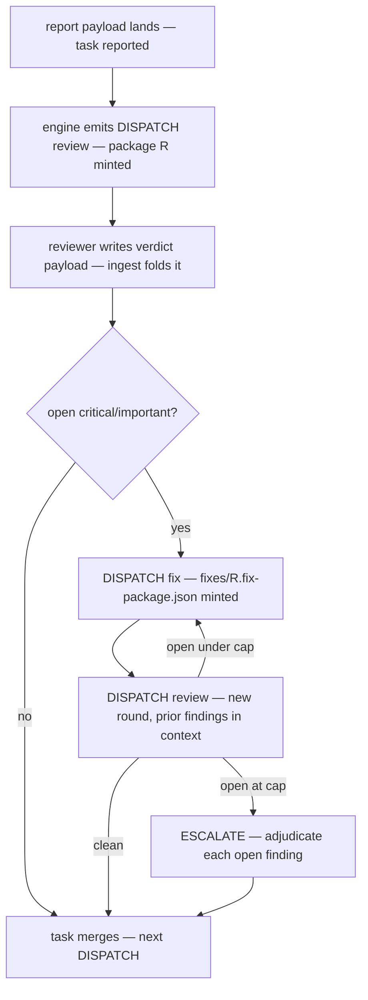

# Executor Review

> **Engine.** `executor <verb>` means
> `python3 <skills-dir>/executor/scripts/executor <verb>`; the engine ships
> inside the router skill, so nothing is on `PATH`.

A review is not a conversation. It is a **round**: the engine mints a
`reviews/R<NN>` slot, packages the diff, and the reviewer's `verdict`
payload — validated against the schema — is the judgment of record. The
round number pairs the judgment with the exact diff it judged, and the
payload outlives the session that produced it.

This skill is dispatch discipline plus three ready templates
(`task-reviewer-prompt.md`, `re-review-prompt.md`,
`final-reviewer-prompt.md`). It owns reviewing; it does not own
implementing, planning, or verification.

## The Two Verdicts (non-negotiable)

Every task review returns **two** fields in its `verdict` payload:

1. `spec_verdict` — `PASS`/`FAIL`: does the diff satisfy its requirements,
   nothing missing, extra, or misunderstood?
2. `quality_verdict` — `APPROVED`/`NEEDS_FIXES`/`APPROVED_WITH_ROUTED_RESIDUALS`:
   is it well-built, tested, maintainable?

The yardstick is the contract — spec requirements, interface documents,
the task's `accepts` — never the reviewer's taste. When the defect is in
the contract itself, the finding says so at contract level, not at the
implementer who followed it.

A review missing either field is not a review. Self-review never replaces
it — that is the implementer grading its own work.

## What Changed From v1

| v1 | v2 | Why |
|---|---|---|
| Verdict a `.md` file under `reviews/verdicts/` | A `verdict` payload validated by schema, journaled, folded | The file was unverifiable prose; the payload is machine-checked and the fold moves on it |
| Findings cited reviewer taste | `findings[]` entries carry `severity`, `claim`, `evidence` — a finding quotes its `path:line` | A finding traces to the contract it breaks, not to an opinion |
| A hand-built diff | The engine writes `reviews/R<NN>.package.json` — `commit_base`, `commit_head`, the diff, every prior finding | The verdict's `reviewed_package_sha` must match — a verdict about another range is rejected |
| Round `R<nn>` was a filename convention | `round` is the engine's minted integer, echoed in the payload | A `round` that lies is a schema rejection, not a numbering slip |

## The Dispatch Contract

When `executor next` emits `DISPATCH` with `role: "review"`:

1. The action's `prompt` names the rendered brief; `context` carries the
   task's contract, the package path, and the `round`.
2. Spawn the reviewer on `task-reviewer-prompt.md` + the engine's brief
   (or `re-review-prompt.md` for rounds after the first), per the
   prompt registry in `references/layout.md`.
3. The worker writes its `verdict` payload to `respond_to` —
   `{"kind":"verdict","task":…,"round":…,"spec_verdict":…,
   "quality_verdict":…,"commit_base":…,"commit_head":…,
   "reviewed_package_sha":…,"findings":[…]}` — and `executor ingest`
   validates and folds it.

`round`, `commit_base`, `commit_head`, and `reviewed_package_sha` echo the
engine's minted values exactly. A verdict naming another range is
rejected before it lands.

## Citable IDs

| Token | Names |
|---|---|
| `INIT-0004-P01-T03` | a task |
| `R07` | requirement 7 of the spec the plan cites |
| `C03` | global constraint 3 of that spec |
| `V03` | criterion 3 of the `vrfy` |

A review round is the payload's integer `round` — the engine mints it and
the verdict echoes it. `R<NN>` is only the file-name shape under
`reviews/`, `audits/`, `repairs/`, and `fixes/`, never a citable id, and
a composite such as `INIT-0004-SPEC-01-R07` is not an id either: cite
`R07` and let the spec anchor it.

**Citation rule:** every ID in a finding belongs to this initiative. A
verdict never names an ID from another initiative — describe the
requirement in words.

## Severity Discipline

| Severity | Means | Route |
|---|---|---|
| `critical` | Bug, security issue, data-loss risk, broken functionality, credential-shaped content in the diff | Fix loop, immediately |
| `important` | This task cannot be trusted until fixed: missed requirement, fragile behaviour, maintainability damage | Fix loop |
| `minor` | Style, polish, "coverage could be broader" | Stays `open`; the final audit triages |
| `info` | Worth knowing, not a defect | Record |

Not everything is `critical`, and a stated rationale in the report never
downgrades a severity.

## The Loop

Two routes leave the loop before it starts:

- **`minor` findings never enter the loop** — they stay `open` in the
  journal and the final whole-branch audit triages them for merge.
- **A plan-mandated finding is a ruling, not a dismissal** — the human
  records it via `executor decide`; a finding is never dropped because
  the plan mandated it.

A reviewer-vs-worker dispute about what the contract requires is a ruling
trigger, not a round: settle it via `executor decide` before dispatching
further. A journaled ruling is obeyed and never re-litigated inside the
loop.

**Where the cap comes from.** `max_fix_rounds` is a policy tunable —
default 5, bounds 1–50 — read from `docs/executor/config.json` (project)
then `docs/executor/<INIT>/meta/policy.json` (initiative), and the
effective value is journaled with the run. `executor status` prints the
`policy:` line with the value and the file it came from. The engine
enforces the cap; a worker never chooses its own.

## Secret Hygiene in Review

A reviewer that spots credential-shaped content in a diff:

1. Flags it `critical`.
2. Records `file:line` and the kind only — NEVER quotes the value into the
   payload. The `claim`/`evidence` fields are journaled and may be
   committed; quoting copies the secret into a second place.
3. Notes that a secret in a diff means the secret is **also in git
   history** — credential rotation, not a file edit.

The controller confirms with `executor check --secrets` (digest-only
report), then **stops and tells the human** — a landed credential is a
security-sensitive condition, one of the four things that stop a run.
History rewriting is the human's call; the incident is recorded as a
`ruling` in redacted form: what kind, which artifact, what was done.

## The Final Whole-Branch Audit

The `review` phase *is* this audit: for every merged plan the engine emits
a plan-level `DISPATCH` with `role: "audit"` — `final-reviewer-prompt.md`,
most capable model. It runs once per plan, before the phase gate, and the
gate means every merged plan passed it. Its `audit` payload's `target` is
the plan ID; it judges:

- **cross-task seams** — the interfaces task reviews cannot see;
- **spec compliance end to end** — every `R<n>` satisfied somewhere;
- **deferred minors and `routed` findings** — triaged for merge;
- **every round-cap disposition** — re-judged on its merits, not inherited.

A `FAIL` is one fix wave — **one** fix dispatch with the complete
findings list, not one per finding — then one re-audit.

## Self-Critique

Before acting on a verdict, check the review itself:

1. **Did the reviewer get the package, not a paraphrase?** The dispatch
   carried the engine's rendered brief — no "focus on", no pre-judgment.
2. **Is every `critical`/`important` finding tied to evidence** —
   `path:line` and a consequence?
3. **Is severity set by consequence**, not by fix size or tone?
4. **Did a re-review do its impact review before closure** — the repair's
   collateral read before the prior findings?
5. **Is any verdict `APPROVED` with an open `important` finding?** That
   is a contradiction the merge gate will trust.
6. **Did you read the diff yourself** instead of the verdict?

## Verification

1. `executor status` — the task's state agrees with the fold.
2. `executor check` — fold clean, no dangling edges.
3. `executor check --secrets` — exit 0 before merge.
4. For a final audit: the plan's `audit` payload is journaled, `verdict`
   consistent with its `findings`.

## Common Rationalizations

| Excuse | Reality |
|---|---|
| "I'll read the diff myself, it's faster" | The diff is the largest artifact in the run; reading it burns the context you need to keep driving. |
| "`HEAD~1` is close enough for the base" | It truncates a multi-commit task to its last commit — the review then passes code nobody read. |
| "The reviewer's response text is the verdict" | It vanishes on the next summarization. The payload is the deliverable; the response is a receipt. |
| "Spec review passed, quality is obviously fine" | Two fields or it is not a review — the schema enforces both. |
| "This finding is obviously wrong, I'll drop it" | Adjudicate only at the cap, and every adjudication is a journaled ruling. Silent discards are forbidden. |
| "One more round will converge" | Past the cap, rounds don't converge — the failure is structural. `ESCALATE`, not another round. |
| "The fix was small, skip the re-review" | Unreviewed fixes are how regressions land. Every round ends with a scoped re-review. |
| "The minors are in the payload, that's enough" | The final audit triages them; a `minor` never blocks but never disappears either. |
| "The implementer already reviewed itself" | Self-review is the author grading its own work — a signal, never a gate. |
| "The review round is done, clean up" | Nothing in either store is deleted by a skill. |
