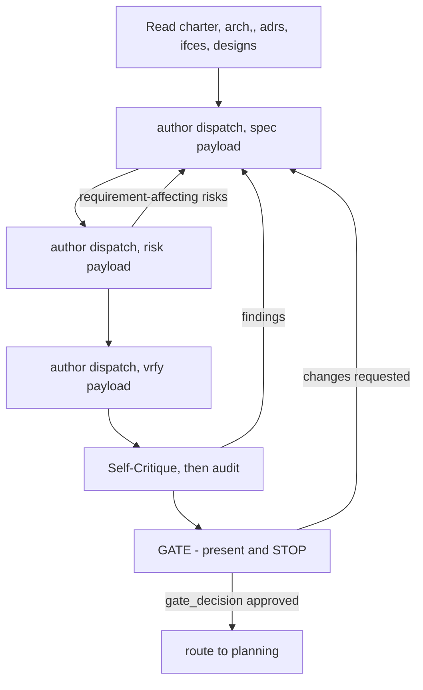

# Specification

This phase produces the artifacts every later phase is measured
against.

Three artifacts, in this order of authoring:

| Order | Kind | Answers |
|---|---|---|
| 1 | `spec` (`INIT-NNNN-SPEC-nn`) | What must be true when this is done — `requirements[]`, `constraints[]` |
| 2 | `risk` (`INIT-NNNN-RISK-nn`) | How this ships and still fails — `risks[]` |
| 3 | `vrfy` (`INIT-NNNN-VRFY-nn`) | What observed output proves each requirement — `criteria[]` |

Order is load-bearing. The pre-mortem changes requirements, so it runs
before the spec settles. The verification strategy must cover the final
requirement set, so it is written last. The engine dispatches an
`author` per kind — each writes its payload to `respond_to`.

## The Spec Is the Authority

**The `spec` artifact is the binding authority. Every plan argues from
it; every `verdict` measures against it.**

- `executor-planning` writes `plan` payloads whose `cites` name this
  spec. A plan is an argument that these tasks satisfy these
  requirements.
- `executor-execution` resolves a plan-versus-spec conflict against the
  spec: if a task's `goal` contradicts a requirement, the requirement
  wins and the plan defect is a `ruling`.
- `executor-review` resolves a finding-versus-plan conflict against the
  spec. A reviewer's `verdict` cites requirement IDs, not opinions.
- `executor-verification` executes the `vrfy` artifact's `criteria`
  row by row.

Everything downstream inherits this document's precision. An ambiguous
requirement is not a documentation problem — it is a defect that ships
as two implementers building two different things and a reviewer
unable to say which is wrong.

**The acceptance bar for this phase:** two competent readers, working
from the spec alone and never speaking to each other, build the same
thing.

## Requirement and Constraint Citation

Requirements and constraints live inside the `spec` artifact:

```text
R07                            requirement 07 — the schema's R\d+ id
C03                            global constraint 03 — C\d+
V05                            verification criterion 05, inside the vrfy — V\d+
INIT-0004-SPEC-01              the spec artifact itself
```

Two digits, sequential from `01`, allocated in writing order and
**never renumbered** — a plan task, a verdict finding, or a `vrfy`
criterion that cites `R07` keeps pointing at the same requirement
forever. Inserting a requirement later takes the next free number
regardless of where it reads in the list.

## Preconditions

Do not start until all of these hold:

| Check | If it fails |
|---|---|
| `executor status` shows `architecture` passed, or `waived` | Stop; that phase is `executor-architecture`'s |
| `design` passed or `waived` | Stop; same owner |
| A decided `brainstorm` artifact exists feeding specification | Stop; run `executor-brainstorm` in design mode |
| Inputs readable — the `charter`, the brainstorm's `Handoff`, every `arch`, `adr`, `ifce`, `design` payload | Read them; never spec against remembered architecture |

**Requirements start from the design session.** Its `Handoff` section
lists requirement candidates, one per use-case flow and success
criterion, each tagged with the flow it came from. Every candidate
becomes a requirement or an explicit out-of-scope entry; the `spec`
payload's `cites` names the brainstorm artifact. A requirement with no
candidate behind it is scope the human never saw in the design — flag
it at the gate.

Read the whole input set before writing one requirement. The spec's
job is to make approved decisions executable, not to relitigate them.
If reading the inputs surfaces a decision nobody made, that gap is an
`adr` — see [Decisions Here Are ADRs](#decisions-here-are-adrs).

If the initiative has no `arch` artifact at all, architecture was
waived. That is legitimate for a small initiative. It does **not**
license inventing structure inside the spec: structural choices are
still `adr`s.

## Procedure



### 1. The `spec` payload

The `DISPATCH` for `schema: "spec"` names the `respond_to` path. The
payload carries:

- `id` — `INIT-NNNN-SPEC-01`
- `requirements[]` — `{id: "R01", requirement, observable, cites[]}`
- `constraints[]` — `{id: "C01", constraint, observable}`
- `sections[]` — the structured body: `prose`, `bullets`, `tables`
  (`columns` + `rows`), and `code`. Never markdown in a string — the
  engine renders the `.md`, and a pipe table or fence is a rejection
- `cites[]` — the `arch`, `adr`, `ifce`, `design`, `brainstorm`, `vrfy`
  ids it argues from

Sections, in order:

| Section | Contains | Why |
|---|---|---|
| Scope | What this spec covers, in one paragraph | A reader must know in ten seconds whether their question is in here |
| Global constraints | What the `constraints[]` mean, verbatim values | Every requirement implicitly includes these; a paraphrased version floor is a different version floor |
| Requirements | What the `requirements[]` demand | The unit a plan implements and a review cites |
| Interfaces | `ifce` ids and the symbols this spec relies on | The seam where two tasks build incompatible halves |
| Out of scope | Itemized, one line each | An unstated non-goal gets built by an implementer being helpful |
| Open questions | Question, owner, blocking or not | An unowned question is answered by whoever notices last |

**Verbatim means verbatim.** `constraint` carries `node >= 20.11.0`,
not "recent Node". The exact string a copy rule requires, the exact
package name and version bound, the exact platform triple. A constraint
an implementer has to interpret is a constraint two implementers
interpret differently.

**Interfaces are cited, never restated.** `cites` names the `ifce`;
the section references `INIT-0004-IFCE-01 · placeCell`. Copying a
signature into the spec creates a second source of truth that drifts
the first time the interface changes. If the interface is wrong or
missing a case, that is an `executor-architecture` change, not a spec
workaround.

**Out of scope is itemized, not gestured at.** "Multi-region is out of
scope" is one item. "Various advanced features are out of scope" is
nothing.

### 2. The `risk` payload

[Risk Documents](#the-risk-payload) below. Requirement-affecting risks
go back into the spec payload now — a redraft is a repair.

### 3. The `vrfy` payload

[Verification Strategy](#the-vrfy-payload) below. `criteria[]` holds
one entry per requirement, minimum, plus one per global constraint.

### 4. Self-review and audit

[Self-Critique](#self-critique) — the adversarial pass the author runs,
then the engine's `audit` dispatch grades all three artifacts against
the `specification` catalog.

### 5. Scan for secrets

```bash
executor check --secrets
```

Exit 0 clean; exit 1 names file:line and the rule — never the value.
Specs attract real values — a connection string in a constraint, a
token in an example payload. Write the shape and the variable name, not
the value.

### 6. The human review gate

[The Human Review Gate](#the-human-review-gate). Present, stop, wait.

## Requirement Quality Rules

Every `requirements[]` entry satisfies all five. A requirement failing
any one is rewritten before the gate.

| Rule | Test | Why |
|---|---|---|
| **Observable** | `observable` names something a person or a command can see from outside | An unobservable requirement cannot be verified, so it cannot be done |
| **Testable** | A `vrfy` criterion can name the `procedure` and the evidence | If you cannot say what proves it, you have written an intention |
| **Unambiguous** | Cannot be read two ways by a competent reader | Two readings become two implementations and an unresolvable review |
| **Atomic** | One requirement, one `id` | A reviewer must be able to reject exactly one thing; "and" in a requirement hides a second requirement that passes while the first fails |
| **Stated once** | Appears in exactly one `R<nn>` | Duplicated requirements drift, and then the spec contradicts itself |

Write `requirement` in the present indicative of the finished system —
"the router rejects a placement request naming an unknown cell with
HTTP 422" — not in the imperative of the implementer.

### No Placeholders

These are **spec failures that block the phase gate**, not style
preferences. An audit finding one is a defect, not a nitpick.

| Placeholder | Why it fails |
|---|---|
| "TBD", "TODO", "decide later", "fill in details" | The decision is still open; a plan built on it argues from nothing |
| "add appropriate error handling" | Appropriate to whom? Every implementer picks differently |
| "add validation" | Which fields, which rules, which failure response |
| "handle edge cases" | Naming the edge cases IS the requirement |
| "write tests for the above" | Test intent without observable behaviour is untestable by definition |
| "similar to X" / "same as the existing Y" | The implementer sees one task, not X. State the behaviour |
| "reasonable", "sensible defaults", "performant", "robust", "user-friendly", "as needed" | Adjectives with no threshold. A number, or delete it |
| A type, function, endpoint, or field named nowhere in this spec or any cited `ifce`/`design` | A dangling reference the implementer must invent |

**Why this is a failure and not a style note:** a placeholder is a
decision you refused to make and billed to someone with less context.
The implementer sees one task. The reviewer sees one diff. Neither has
the charter, the ADRs, or the conversation you had. The decision gets
made anyway — by whoever is furthest from the information needed to
make it well, under time pressure, invisibly.

An open question you genuinely cannot answer is not a placeholder. It
goes in **Open Questions** with a named owner and a blocking flag,
where the human sees it at the gate.

## Self-Critique

Run all of these yourself after the three payloads exist — an
adversarial pass before the audit dispatch grades them. Redraft inline.

**1. Placeholder scan.** Search all three payloads for the ban list:
`TBD`, `TODO`, `appropriate`, `edge case`, `similar to`, `as needed`,
`robust`, `performant`, `sensible`, `reasonable`, `etc\.`, `and/or`.
Every hit is either rewritten or justified in one clause.

**2. Internal consistency.** Do two requirements contradict? Does a
requirement contradict a global constraint, an `adr`'s consequence, or
the charter's non-goals? Does the spec's scope section match the
requirements actually present? On a contradiction with an `adr`, the
`adr` wins — the spec is downstream.

**3. Scope check.** Is this plannable? If the requirements split into
two groups sharing no interface and no requirement, the decomposition
question belongs to the charter — a spec does not absorb independent
subsystems.

**4. Ambiguity check.** Read each requirement adversarially, hunting
for a second reading. Ask of each: what would a hostile-but-competent
implementer be allowed to build here? If any requirement supports two
readings, **pick one and make it explicit** — do not add "either is
acceptable", which just moves the ambiguity into the review.

**5. Coverage against architecture and interfaces.** The check most
often skipped, and the only one that catches a requirement nobody
wrote. Build the table, keep it in a spec section:

| Source | Item | Specified as | Or out of scope because |
|---|---|---|---|
| `INIT-0004-IFCE-01` | `placeCell` | R03, R04 | — |
| `INIT-0004-IFCE-01` | `evictCell` | — | OOS-02: automated eviction not built |
| `INIT-0004-ADR-02` | Tenant isolation boundary | R09 | — |

Every symbol in every cited `ifce`'s `provides` list is **either
specified or explicitly out of scope**. A blank cell in both columns
is a hole in the contract: the interface exists, nothing requires it
to work, and nothing will verify it.

**6. Design traceability.** Walk the brainstorm's `Handoff`
candidates: each maps to a requirement or an out-of-scope entry. Walk
the requirements: each traces to a candidate, or is flagged as new
scope. Walk the session's failure and abuse flows: each has a
requirement saying what the system does, or an explicit out-of-scope
entry.

**7. Verifiability.** For every requirement, `observable` names the
observation that would prove it false. A requirement nothing could
falsify cannot get a `vrfy` criterion — rewrite it with a threshold,
an observable, or an exact value.

**Re-run the loop after any fix that changed requirement text.** A
split or tightened threshold can break check 2 and check 5 elsewhere.

## The `risk` Payload

A real pre-mortem, not a list of things that sound bad. `risks[]`
carries `{id, risk, likelihood, impact, mitigation}`; the sections
carry the narrative.

### 1. Write the failure history backwards

Assume the initiative **shipped and failed**. Fix a date far enough
out that the failure has consequences. Write the history in past
tense, three to eight sentences, naming what users and operators
actually saw:

> It is 2027-01. Cell placement shipped in September. By November,
> placement latency at 8k tenants had tripled and two tenants were
> co-located on a cell that then lost its disk. The on-call runbook had
> no entry for a split cell, so recovery took eleven hours. We rolled
> the feature back in December and the migration path back to shared
> storage did not exist.

Past tense is the technique, not decoration. "Latency might degrade"
is a worry you can wave away; "latency had tripled by November" forces
you to say how, and the how is the risk.

### 2. Enumerate causes that trace to the history

Every `risks[]` entry must trace to a sentence in the narrative, and
every sentence in the narrative must produce at least one entry. That
coupling is what stops a pre-mortem from decaying into a generic risk
checklist copied between projects.

Then invert as a second pass: how would you *guarantee* this fails?
Merge, dedupe, and drop anything that does not touch the narrative —
an unnarrated risk usually belongs to a different initiative.

### 3. Rate by likelihood and impact

The schema's `likelihood`/`impact` are `high | medium | low`. Sort by
impact first, likelihood second. A low-probability irreversible risk
outranks a likely contained one, because you can fix contained things
twice.

### 4. Every mitigation lands in a real later phase

A `mitigation` must name where it lands:

| Landing site | Form |
|---|---|
| This spec | A new or tightened `R<nn>` or `C<nn>` |
| Verification | A `vrfy` criterion that would catch it |
| Planning | A named task-shaped deliverable the plan must contain |
| Architecture | An `adr` to revisit, named by ID |

**A mitigation with no landing site is not a mitigation — it is a
wish.** "Monitor placement latency" is a wish; "R11: the placement
service emits a `placement_latency_ms` histogram, proven by criterion
V11" is a mitigation.

### 5. Feed requirements-affecting risks back into the spec

Do this before the gate, while the spec is still being authored. A
risk whose mitigation is a requirement changes the requirement set,
which changes the coverage table and the criteria count.

### 6. Name what you accept

A risk accepted without mitigation is named in `mitigation` as
accepted, with two things:

1. **Why accepted** — the cost of mitigating exceeds the expected
   loss, or the mitigation belongs to a later initiative, or the
   trigger condition is outside the charter's scope.
2. **What would change the judgment** — the observation that reopens
   it. "If tenant count passes 12k" or "if a second team starts
   writing to these cells."

Without the second, "accepted" means "ignored, in writing".

## The `vrfy` Payload

`criteria[]` — `{id: "V01", criterion, procedure, cites[]}` — with
`cites` naming the `R<nn>`/`C<nn>` it proves (and the spec). The
schema requires at least one criterion: a `vrfy` with none would make
the verification gate pass with nothing proven.

### One criterion per requirement, minimum

Every `R<nn>` gets at least one `V<nn>` citing it. A requirement
needing two methods — a unit test for the calculation and a manual
check of the rendered result — gets two. **Every `C<nn>` global
constraint gets one too**: a version floor nobody checks is a version
floor nobody meets.

- `criterion` — what must be true, quoting the requirement's sense
- `procedure` — the exact command, or numbered manual steps
- `cites` — the requirement/constraint ids it proves

### Evidence means observed output

`executor-verification`'s `evidence` workers can only report what this
artifact told them to observe. **Vagueness here becomes an
unverifiable claim there** — a worker handed "tested thoroughly"
either invents a check or reports a pass nobody can audit.

Disqualified as a `procedure`, always:

| Disqualified | Replace with |
|---|---|
| "tested thoroughly" | The command and its expected output |
| "works" / "behaves correctly" | The specific assertion that holds |
| "tests pass" | Which test file, which test name, how many assertions |
| "verified manually" | Numbered steps and the expected state after each |
| "no errors" | Exit code 0 plus the named absence you checked for |
| "looks right" | The named screen state, field value, or rendered string |

Acceptable procedures name something a second person could observe
independently:

- `pytest tests/placement/test_scoring.py -v` → `12 passed`, exit 0
- `curl -s -o /dev/null -w '%{http_code}' …/place -d '{"cell":"nope"}'`
  → `422`
- `node --version` → a version string `>= 20.11.0` (constraint `C02`)
- Manual: (1) open the cell list; (2) click **Evict** on `cell-3`; (3)
  the row shows `draining` within 2s; (4) the audit log gains one
  `cell.evict` entry naming `cell-3`

A manual procedure a stranger cannot perform cold is a vague one.
Numbered steps, one observation per step.

### Negative and boundary criteria

A requirement stating a rejection, a limit, or an error response needs
a criterion that proves the *failure* path, not only the happy one.
"Rejects an unknown cell with 422" is verified by sending an unknown
cell and observing 422 — not by observing that valid requests still
work.

## The Human Review Gate

After the audits clear, `executor next` emits `GATE specification` —
a pick-class gate: it never clears automatically, whatever the
autonomy file says. Present and **STOP**:

> Specification written for `INIT-0004`:
> - `spec` — 14 requirements, 7 global constraints
> - `risk` — 9 risks, 6 mitigated, 3 accepted
> - `vrfy` — 24 criteria
>
> Open questions needing you: Q1 (blocking), Q2 (non-blocking).
> Risks accepted without mitigation: 3 — A01, A02, A03.
>
> Please review before I write the implementation plan.

Then wait.

| Rule | Why |
|---|---|
| Do not write a plan, scaffold a project, create a branch, or touch code | The gate is the approval, not the artifact's existence |
| Silence is not approval | Nothing acquires consent by aging |
| "Looks good" is approval; "looks good, but what about X" is a change request | The question is the change request |
| A change request re-runs the **full** self-critique loop | A one-line requirement change can break coverage three sections away |
| Only explicit approval passes the gate | A `gate_decision` claims a human agreed; never claim it for them |

The artifact scales with the work — a small initiative's spec is six
requirements and two constraints. The approval never scales.

**The gate ends your turn.** The presentation above is the last thing
in your message — no pre-reading the planning skill, no drafting
requirement tables "in case they approve". A spec gate crossed without
approval poisons every plan that argues from it.

## Supersession

**While no plan exists**, redraft freely — the fold keeps the latest
payload; nothing downstream depends yet.

**Once any plan exists** — a `plan` payload `cites` this spec — a
material change is a **new spec artifact**, never a silent redraft.

Why: a plan that argued from a spec that silently changed is built on
sand. The implementer read one requirement, the reviewer measures
against another, and the diff between them exists nowhere. A second
`spec` artifact (`INIT-NNNN-SPEC-02`, supersession recorded in its
sections) makes that diff a document.

### Material versus non-material

| Change | Material? |
|---|---|
| Requirement added, removed, or split | Yes |
| Requirement renumbered | Never — numbers are permanent once cited |
| Threshold, value, version floor, or exact string changed | Yes |
| Out-of-scope item moved in scope, or in-scope item moved out | Yes |
| Constraint added or relaxed | Yes |
| Typo, formatting | No |
| A sentence clarified so it reads the way it was always implemented | No |

**The test:** could a reviewer's verdict change, or could a task's
implementation change? Then it is material. When unsure, supersede.

### Superseding, step by step

1. Author the new `spec` artifact. Requirement numbers that survive
   **keep their numbers**; every citation in every plan, verdict, and
   criterion depends on it. New requirements take the next free
   number. Removed requirements leave a one-line tombstone naming
   what replaced them.
2. Redraft the old spec marking it superseded — body otherwise
   untouched.
3. **Re-link verification.** New `vrfy` artifact if criteria changed;
   the `vrfy` must never name a superseded spec in `cites`.
4. **Notify plan authors.** Every plan citing the old spec is either
   re-argued against the new spec or explicitly confirmed unaffected —
   a `ruling` per plan records which. A plan mid-execution needs its
   controller told now, not at review.

## Verification

How you know the specification phase produced what a plan can be written
against — run before routing to the gate:

1. **The payloads validated.** Each artifact landed via `executor ingest`
   with a named acceptance; a payload the schema rejected is not written,
   it is fixed or re-authored. A rejection the thinking ignores is a
   defect recorded, not a formality.
2. **Coverage is closed.** Every charter goal is argued by at least one
   `requirements` row; every row has a `criteria` entry in the `vrfy`
   payload; every global constraint has one. `executor graph` shows the
   subgraph — a goal with no requirement and a requirement with no
   criterion are both visible as a missing edge, not a judgement call.
3. **Every ID resolves.** Every `cites` entry names an artifact that
   exists; a dangling reference is an audit finding before it is a human
   one.
4. **The secret scan passed.** `executor check --secrets` exit 0.
5. **The gate opened.** `executor next` shows the `specification` gate
   awaiting a decision; the payloads, not the reply text, are what the
   human approves.

## Decisions Here Are ADRs

A decision made during this phase is an **`adr` artifact**, not a
`ruling`.

| Concept | When | Where | Requires |
|---|---|---|---|
| `adr` | Discovery, architecture, design, specification | a tracked artifact, human in the loop | Nothing but the initiative |
| `ruling` | Execution, controller deciding without the human mid-run | a journal payload via `executor decide` | A running phase |

A structural gap you discover while specifying goes to
`executor-architecture` as an `adr`. A question only the human can
answer goes in **Open Questions** with an owner, where the gate
surfaces it. It does not become a ruling and it does not get quietly
decided.

## Common Rationalizations

| Excuse | Reality |
|---|---|
| "The requirement is obvious from the architecture" | The implementer reads one task, not the architecture. If it is not a requirement, it is not required. |
| "I'll write 'appropriate validation' and the implementer will figure it out" | They will, differently from the reviewer. That is the failure, not a shortcut. |
| "TBD is fine, I'll fill it in during planning" | Planning argues from the spec. A TBD makes the plan argue from a blank. |
| "The pre-mortem is ceremony, the risks are obvious" | Obvious risks are the ones nobody assigns a mitigation to. Name the landing site or accept it in writing. |
| "'Tested thoroughly' is enough, the verifier will figure out how" | The evidence worker can only observe what the `procedure` names. It becomes an unverifiable claim. |
| "One criterion per feature is enough" | A reviewer rejects one requirement, not one feature. Criteria are per requirement. |
| "Small change, I'll just redraft the spec" | A plan exists. Supersede, re-link the `vrfy`, tell the plan authors. |
| "I'll record this decision as a ruling" | Rulings are runtime decisions mid-run. This is an `adr`. |
| "The user hasn't objected, so I can start planning" | Silence is not approval. |
| "Two specs is bureaucratic, I'll write one big one" | If the halves share no interface and no requirement, one artifact just hides that they are two. |
