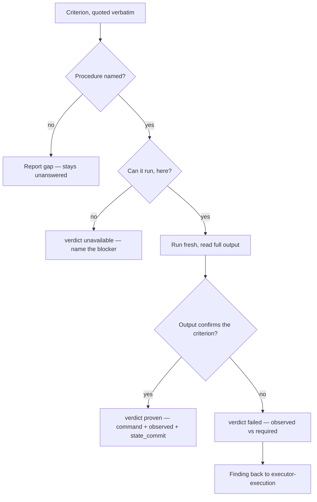

# Executor — Verification

The phase that converts claims into evidence. Everything before this produced
intent (charter, spec, plan) or activity (commits, reports, verdicts). None of
that is proof that the software works. This phase produces proof, or names
exactly what is unproven.

Read [`../executor/SKILL.md`](../executor/SKILL.md) first for the ID
grammar, the citation rule, and the phase table. The engine emits the
`DISPATCH` actions; every command below is `executor <verb>`.

## The Iron Law

```text
NO COMPLETION CLAIM WITHOUT FRESH EVIDENCE FROM THE CURRENT STATE
```

Evidence is bound to state, not to a session. The freshness rule:

- Evidence recorded against the current, unchanged state is **not
  re-run**. Re-running a green check to feel better is wasted work,
  not rigour — this holds across session boundaries and resumes.
- **Any change to the code under test invalidates every piece of
  evidence that exercised it.** After a fix lands, the affected
  criteria need fresh `evidence` payloads at the new `state_commit`.
  Unaffected evidence stays valid.
- A new round never edits an old one: the journal appends. `check`
  verifies the chain, so an edited past is a detected one.

The Iron Law follows from the freshness rule: if you have not run the
check against the code as it exists now — this session or an unchanged
prior one — you cannot say it passes. Not "should pass", not "passes
now", not "verified earlier". Previous evidence is evidence about a
previous commit.

## The Gate Function

Run this before any status statement, any expression of satisfaction, any
commit, any handoff, any move to the next task:

1. **IDENTIFY** — what exact command or observation proves this claim?
2. **RUN** — execute it fresh and in full. No partial runs, no `-k` filters
   chosen to make it green, no cached result.
3. **READ** — the whole output. Exit code. Failure count. Skip count.
4. **VERIFY** — does the output confirm the claim, or merely fail to
   contradict it? If NO: state the actual status with the evidence. If YES:
   state the claim *with* the evidence.
5. **RECORD** — command, observed output, and the commit it ran against, into
   the evidence ledger.
6. **ONLY THEN** — make the claim.

**Skipping a step is lying, not shortcutting.** There is no step in this list
that costs more than the retraction it prevents.

## Inputs

| Input | Where | Why it is needed |
|---|---|---|
| Verification strategy | the `vrfy` artifact's `criteria[]` — `criterion`, `procedure` | The list of requirements and the evidence each one names |
| Spec | the `spec` artifact's `requirements`/`constraints` | Requirement text is quoted verbatim from here |
| Final review | the plan's `audit` payload | Tells you what review already found — it does not tell you the software works |
| Plan(s) | `plans/<PLAN-ID>/plan.json` and its tasks | Where findings go back |
| The state under test | `git rev-parse HEAD`, `git status --short` | Every evidence payload's `state_commit` stamps it |

If the initiative has no `vrfy` artifact, verification cannot proceed as
specified: the acceptance criteria were never written down. Do not invent
them — report the missing artifact; `executor-spec` owns writing it.

## Establish the state under test — first, always

```bash
git branch --show-current
git rev-parse HEAD
git status --short
```

Record the branch and the short HEAD. Every ledger row carries it.

**A dirty tree means the evidence is against an unrecorded state.** Say so in
the ledger explicitly (`a91e502 + uncommitted changes`) or commit first.
Evidence stamped with a commit that does not contain the code you tested is
worse than no evidence — it is a false record.

## Executing the strategy

Walk the `vrfy` artifact's `criteria` **in its order**. Never batch,
never sample, never skip ahead to the interesting ones.



Per requirement:

1. **Restate it verbatim.** Copy the criterion's `criterion` text into the
   payload unedited. Paraphrasing narrows a requirement to whatever you
   happened to test.
2. **Identify the evidence it names.** The `procedure` says which method.
   Use that one. If you substitute a different check, the substitution is
   a `ruling` via `executor decide`, not a silent swap.
3. **Run it fresh.** Full command, current state, complete output read.
4. **Record** the exact command in `command`, the observed output in
   `observed` (trimmed to the deciding lines), and `state_commit`.
5. **Mark `verdict`** from the four statuses.

### The four statuses

The engine dispatches `role: "evidence"` per criterion and the worker's
`evidence` payload carries `verdict` — one of three values, plus the
missing-evidence state the fold keeps open:

| Status | Means | Rule |
|---|---|---|
| `proven` | The named evidence ran fresh against the current state and its output confirms the requirement | Requires a recorded `command` and `observed` output at the `state_commit`. Nothing else earns this word. |
| `failed` | The evidence ran and contradicted the requirement | `observed` records observed vs required. Becomes a finding. |
| `unavailable` | The evidence cannot be gathered in this environment | `observed` states the exact missing condition. Not a pass — a documented hole the human accepts at the gate. |
| no payload | The criterion was never run — the fold keeps its slot open | **Never upgraded to `proven` by inference.** A criterion nobody checked is unproven regardless of how obviously it "must" work. |

### An unanswered criterion is the status that prevents fabricated completion

Most false completion claims are not lies about a failing check. They are
criteria that were never run, absorbed into a summary sentence about the
ones that were. Therefore:

- Every criterion starts without an `evidence` event and is only moved
  by a payload `executor ingest` accepts.
- `executor status` reports the counts: `N proven · N failed ·
  N unavailable · N unanswered`. They are never omitted for tidiness.
- A single unanswered criterion blocks the word "complete". The correct
  sentence is "11 of 12 criteria proven, 1 unanswered: <which, and why>".
- Never write `proven` because a neighbouring criterion passed, because
  the implementer said so, or because the code obviously does it.
  Obviousness has no exit code.

## Evidence types — what each proves and what it does not

| Type | Proves | Does NOT prove |
|---|---|---|
| Unit | One unit honours the contract its assertions state | That the unit is wired in, that callers use it correctly, that the feature works |
| Integration | One seam between components behaves as specified | Anything about the seams it does not cross, or the whole path end to end |
| Smoke | The thing starts and performs its main job for real | Edge cases, error paths, load behaviour, correctness beyond what you observed |
| Manual | A human observed a specific behaviour at a specific time | Repeatability, regression safety, anything the human did not look at |
| Static | The code parses, types check, lints clean, schema validates | That it compiles/builds, runs, or is correct. Ever. |

### The mismatch rule

**Evidence proves what it exercises, not what it is near.**

- A green unit suite is not evidence the feature works end to end.
- A green linter is not evidence the build succeeds.
- A successful build is not evidence the program runs.
- A running program is not evidence it does the right thing.
- A passing test is not evidence the test would fail if the code broke —
  that requires the red-green check below.

When the procedure names integration evidence and you only have unit
evidence, the criterion stays unanswered — not "mostly proven".

### Regression tests: red-green or it proves nothing

A test written to lock in a fix is only evidence if it has been seen to fail
without the fix:

1. Write the test, run it — it passes.
2. Revert the fix, run it again — it **must** fail. Read that failure.
3. Restore the fix, run it — it passes again.

A test that has only ever been green may be asserting nothing. Record both
observed outcomes, or the criterion stays unanswered.

## Smoke-test discipline

**Run the actual thing, not the test file.** Launch it, exercise the changed
path, observe the result with your own tool output.

| Surface | What counts as smoke evidence |
|---|---|
| Web UI | Driven in a real browser: navigate, interact with the changed path, observe rendered state. A screenshot or the assertion you read from the page. |
| TUI | Launched for real in a terminal, keys sent, output observed. |
| CLI | The binary invoked with real arguments, stdout/stderr and exit code read. |
| Service / daemon | Started, readiness observed (not assumed from process creation), a real request issued, the response read. |
| Library | A caller written or an existing caller exercised — the public entry point, not an internal function. |

Rules:

- Process creation is not readiness. Observe the readiness signal (log line,
  port accepting, prompt).
- Exercise the **changed** path. Starting the app and seeing the home page
  proves the app starts, nothing about your change.
- **If visual verification is genuinely impossible, say so explicitly** —
  "could not verify visually: no display/browser available in this
  environment" — and mark the criterion `unavailable`. Never let a reader
  infer you looked at something you did not.
- Clean up what you started (processes, tabs, temp files) after the evidence
  is recorded, and only what you started.

## The evidence record

The evidence record is the journal's `evidence` events — one per
criterion per round — and the `summary` view renders them as the
outcomes table. There is no hand-written ledger: `executor status`
prints the counts, `executor check` verifies a cited `state_commit`
exists, and `executor ingest` validates every payload against the
schema. An `evidence` payload with no `observed` output is a schema
rejection — the record is the output, not the verdict word.

**Criterion references:** use the `vrfy` artifact's own `criteria[].id`,
verbatim. Never mint a criterion id and never renumber.

**Citation rule:** every ID in a payload belongs to this initiative — a
dependency on another initiative's work is stated in your own words; the
charter's `cites` is the only place another initiative's ID appears.

**Every criterion's payload carries the record.** The `command` and
`observed` fields are what makes the `verdict` real — a `proven` with no
recorded output is an assertion, not a record; an `unavailable` records
the exact missing capability.

An example of what a well-formed payload looks like:

```json
{"kind": "evidence", "v": "v1", "dispatch_id": "D00112",
 "criterion": "INIT-0004-VRFY-01-#3",
 "command": "bun run start && curl -XPOST localhost:3000/place",
 "observed": "listening on :3000; POST /place → 200 {placed: cell-2}",
 "verdict": "proven",
 "state_commit": "a91e502",
 "artifacts": []}
```

### Per-state evidence

validity: `state_commit` in every payload names the commit the run
happened at, and `executor ingest` rejects an `evidence` whose
`state_commit` does not resolve (`unknown_rev`) or whose named
`artifacts` do not exist at that rev (`missing_evidence`). A `proven`
payload at a stale commit is evidence about previous code — the
criterion stays open until a fresh run lands.

When an evidence run is a `DISPATCH` rather than a command you run
yourself, its agent is `evidence`-role; the template is
[evidence-runner-prompt.md](evidence-runner-prompt.md). Fill every
placeholder — the criterion, its procedure, its pass condition, and the
commit verbatim — and specify the model explicitly.

## Redaction

`observed` output is journaled — the journal is durable and exported at
handoff. Command output can contain tokens, `Authorization:` headers,
credentialed URLs, or `.env` echoes. Trim to the verdict lines and redact
shapes (`Bearer <redacted>`) before the payload is ingested — never a
real value. Then confirm:

```bash
executor check --secrets
```

Exit 1 names the rule and the file:line — never the value. On a finding:
do not echo it, tell the human which file, which line, what kind.

## Findings back to execution

A `failed` criterion, or a confirmed gap behind an unanswered one, is a
finding that returns to `executor-execution`. Verification does not fix it.

**The verifier does not patch the code.** Fixing it yourself destroys the
independence that made your evidence worth having, and silently rebases
every other criterion onto a commit you did not test. Hand it back.

A finding is a `needs_context` report from the `evidence` worker, or a
recorded `ruling` — it carries exactly this:

```markdown
Finding — INIT-0004-VRFY-01-#2

Requirement: <verbatim>
Observed: <the output line that contradicted it>
State: a91e502
Severity: [blocking | non-blocking]
Where it appears to live: `src/router/place.ts` — capacity check after insert
Re-verification: re-run `bun test test/router.int.ts` and the #3 smoke path
```

Then: `executor next` routes the fix through `executor-execution` — a
fix dispatch on the owning task if one exists, or a new task in a new
plan if the gap is genuinely new work (`executor-planning` owns that).
When the fix lands, the affected criteria open again and a fresh
evidence dispatch covers them.

Verification-time decisions taken without the human — reclassifying a
criterion as `unavailable`, substituting one check for another,
accepting a narrower observation as sufficient — are rulings, recorded
the moment they are made:

```bash
executor decide - <<'JSON'
{"kind": "ruling", "v": "v1",
 "decision": "verification: accepted CLI smoke instead of browser smoke for #7",
 "why": "no display in this environment; the changed path is CLI-reachable",
 "cost_if_wrong": "if the rendering layer regressed, this run would not catch it"}
JSON
```

## The completion gate

The gate passes when **every criterion in the `vrfy` artifact has a
verdict backed by a record**, and the human accepts the `failed` /
unanswered / `unavailable` set.

- Never convert an expected result into an observed one. "The command
  would print 0 failures" is not a record.
- Never let the summary contradict the payloads. If one criterion has
  no `evidence` event, the summary names it.
- Report the shape honestly — `executor status` prints it:
  `N proven · N failed · N unanswered · N unavailable`, then the named
  exceptions with their exact conditions.

**The completion gate is a human stop.** When `executor next` emits
`GATE` for `verification`, present the counts, the exceptions, and the
evidence dispatches — and end your turn. The human accepts the
`failed` / unanswered / `unavailable` set or sends work back; you do not
declare the initiative complete on your own authority, and you do not
start handoff in the same message. An acceptance that never happened is
the exact fabrication this phase exists to prevent.

The human records it:

```bash
executor decide - <<'JSON'
{"kind": "gate_decision", "v": "v1", "phase": "verification",
 "decision": "approved", "by": "human",
 "note": "12/12 proven at a91e502"}
JSON
```

The engine enforces the ordering: `gate_decision` is rejected
(`no_open_gate`) until `next` has opened the gate, and a `passed` phase
cannot be re-decided. A run with unproven criteria stays `entered` —
an `entered` phase with an honest reason is recoverable; a fabricated
approval is a lie the human writes, not the engine. `waived` instead of
`approved` is how the human records accepting a residual set.

**The loop closes on evidence, not on rounds.** After a fix lands,
the affected criteria need fresh evidence at the new commit — not just
the failed one. A fix that changes shared code invalidates the evidence
that covered its consumers. Verification ends when every criterion is
`proven` at the current state, or the human explicitly accepts the
residual set.

**Verification is the phase that must not be skipped.** If the human
explicitly waives it (a docs-only initiative with no executable
surface), the `gate_decision` carries `decision: "waived"` and the
`reason` — never an omission. The `waived` decision is what
distinguishes a choice from nobody looking.

## Pre-claim checklist

Before any sentence that implies the work is done:

- [ ] Every criterion has an `evidence` payload, and every verdict is
      backed by `command` + `observed` + `state_commit`?
- [ ] Every `proven` backed by a command I ran in this session, whose
      output I read, at the `state_commit` recorded?
- [ ] The state under test recorded, and the tree's dirtiness stated?
- [ ] Evidence type matches what the criterion's `procedure` names?
- [ ] Smoke evidence from the actual thing, not from a test file?
- [ ] Regression tests red-green verified?
- [ ] Worker reports verified against `git diff`, not taken at face value?
- [ ] `unanswered` / `failed` / `unavailable` counts stated in the summary?
- [ ] Findings raised for every failure and gap?
- [ ] Every payload accepted by `executor ingest` — no rejections open?
- [ ] `executor check --secrets` clean on what I ingested?

An unchecked box means the claim is not ready. State the actual status instead.

## Self-Critique

Before claiming verification, attack your own evidence trail:

1. **Is any `proven` backed by output from a different `state_commit`**
   than the one being claimed? Evidence is valid only at the commit it
   was captured on.
2. **Did any evidence run change code, tests, or config to get green?**
   Then the criterion was not proven — it was edited.
3. **Is any unanswered criterion described as passing, or omitted?**
   Each one is a stated gap the human must accept.
4. **Does each `observed` field, read cold, reach the same verdict**
   without trusting your summary?
5. **Is any criterion verified only by a unit suite** when its
   `procedure` names a smoke or manual method on the real surface?
6. **Did a worker's `report` stand in for evidence?** A report is an
   assertion; only the `evidence` payload's `observed` output counts.

## Verification

Run these in this session and cite their output with the claim:

1. `git rev-parse --short HEAD` — matches the `state_commit` of every
   `proven` payload.
2. `executor check` — exit 0: journal chain verifies, no dangling
   edges, state cache fresh.
3. `executor check --secrets` — exit 0 on the store.
4. `executor status` — its proven/failed/unanswered/unavailable counts
   equal the ones you are quoting.
5. A `gate_decision` for `verification` lands only when every criterion
   is `proven` or explicitly accepted by the human.

## Common failures

| Claim | Requires | Not sufficient |
|---|---|---|
| Tests pass | Test command output: 0 failures, and the skip count read | A previous run, "should pass", a filtered subset |
| Linter clean | Linter output: 0 errors | Partial path, extrapolation from one file |
| Build succeeds | Build command: exit 0 | Linter passing, "logs look fine" |
| Types check | Type checker: exit 0 | Editor showing no squiggles |
| Bug fixed | The original symptom reproduced, then re-run and gone | Code changed and reasoning about it |
| Regression test works | Red-green cycle observed | The test passing once |
| Feature works | Smoke evidence from the real surface | A green unit suite |
| Subagent completed | `git diff` inspected, files read | The agent's report saying success |
| Review clean | The `audit` payloads on the plan, read from the journal | A summary of them in someone's message |
| Requirements met | Every criterion carries an `evidence` payload | "All tests pass, so we're done" |
| Initiative complete | Every criterion `proven` or human-accepted | Review verdict clean |

## Red flags — stop

- "should", "probably", "seems to", "looks right", "must be fine"
- Expressing satisfaction before verification — "Great!", "Perfect!", "Done!"
- About to commit, push, open a PR, or hand off without the payloads ingested
- Trusting an implementer or reviewer success report
- Partial verification standing in for the whole requirement
- Thinking "just this once" or "it's obviously fine"
- Tired and wanting the work over
- Writing a summary sentence that covers requirements you did not check
- Upgrading an unanswered criterion while writing the summary
- Any wording that implies success without a command behind it

## Rationalizations

| Excuse | Reality |
|---|---|
| "The tests passed so it works" | The tests prove what they assert. Run the thing. |
| "The implementer reported it working" | A report is an input, never evidence. Verify independently. |
| "The reviewer approved it" | Review checks the diff against the spec. It does not run the software. |
| "Should work now" | Run the verification. |
| "I'm confident" | Confidence is not evidence. |
| "Just this once" | No exceptions. The exception is the failure mode. |
| "The linter passed" | A linter is not a compiler, and a compiler is not a runtime. |
| "I ran it earlier" | Earlier was a different commit. Evidence is per-state. |
| "It's obviously covered by criterion 3" | Then criterion 4 names its own evidence for a reason. Run it or it stays unanswered. |
| "I'm tired" | Exhaustion is not an excuse, it is a reason to stop and report honestly. |
| "Partial check is enough" | Partial proves the part. The requirement is the whole. |
| "No display, so I'll assume the UI renders" | Mark it `unavailable` and say so. Assumption recorded as evidence is fabrication. |
| "I'll summarize it in chat, not ingest it" | Chat is lost. The journal is the record. |
| "Different words, so the rule doesn't apply" | Spirit over letter. The rule covers implications. |
| "I'll just fix the failure while I'm here" | Then you tested a commit that no longer exists and lost your independence. Hand it back. |
| "Re-running everything is more rigorous" | Evidence for an unchanged state is still valid. Rigour is running what changed, not everything twice. |

## When this applies

Always, before: any variation of a success or completion claim; any expression
of satisfaction; any positive statement about work state; committing, pushing,
opening a PR; marking a task or phase complete; handing off to
`executor-handoff`; delegating to a subagent whose result you will report.

The rule binds exact phrases, paraphrases, synonyms, implications, and any
communication that would leave a reader believing the work is done.
