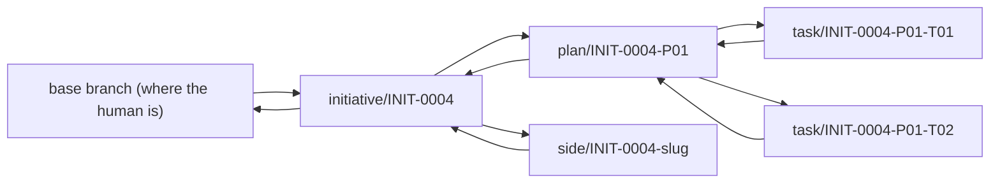

# Branch Model

One branch per level, named after the entity, merged on the gate its level
requires. `git branch --list` is the registry. The engine enforces the
*mechanically checkable* half — descent, ownership, base-branch purity, merge
direction, the commit-subject convention — and this document owns the rest:
which fork, which order, which gates, which worktree.

## The hierarchy



| Direction | Gate the merge requires |
|---|---|
| task → plan | the task's latest review round is clean — `spec_verdict` pass and `quality_verdict` approved |
| plan → initiative | every task reviewed and merged **and** the plan's whole-plan audit clean (the `review` phase) |
| side → initiative | a human `ruling` naming the slug — a side branch is not a task and earns no verdict |
| spike → never | abandoned; never merged |

The **initiative branch** is the only integration line: plan and task
branches never fork from `main` and never merge to it. `hotfix/<slug>` is
the one branch outside the hierarchy — it forks from the base and merges back,
because an urgent fix must not wait for an initiative.

## What the engine enforces

Six rules, each with a rejection code in `references/rejections.md` and a
clear-the-path hint in the refusal. They are checked when a payload answers a
dispatch this engine minted (`context.rules == "v2"`); a dispatch already
open at upgrade time is judged by the rules it was asked under, so an upgrade
never rejects the work it inherited. `executor status` says when that
exemption is in force.

| Rule | Checked on | Code |
|---|---|---|
| **G1 descent** — the reported head descends from the dispatch base | `report` | `not_descendant` |
| **G2 base-branch purity** — the head is not contained in the branch the dispatch forked from (no commit on the integration line) | `report` | `commit_on_base` |
| **G3 ownership** — `task/<TASK-ID>` contains the head, and `report.branch` (when present) names it | `report` | `branch_mismatch` |
| **G4 merge ancestry** — the merge contains every task head of the plan it claims | `merge` | `merge_not_descendant` |
| **G5 merge branch** — `merge.branch` exists, is `plan/<PLAN-ID>` or `initiative/<INIT-ID>`, and contains `merge_sha` | `merge` | `merge_branch_mismatch` |
| **G6 commit subjects** — every subject in `base..head` matches the convention below | `report` | `bad_commit_message` |

The commit-subject convention, enforced verbatim:

```
^(feat|fix|chore|docs|refactor|test|perf|build|ci)(\([a-z0-9._/-]+\))?: \S.*$
```

A dispatch's `prompt.md` records the rules it was minted under (`rules: v2`),
so the worker can see what will be checked.

## What stays procedural — the skill's job

| Rule | Why it is not in the engine |
|---|---|
| Fork mechanics (`initiative/` from base, `plan/` from initiative, `task/` from the plan tip) | the engine checks the *consequence* (G1, G3), not how the branch was created; `git branch` mutation is the skill's job |
| Worktree choice for concurrent tasks | a local workflow decision; no journal object describes it |
| Merge ordering across plans | the human/pump owns it; the engine judges one merge at a time |
| One-task-per-branch isolation | a task branch that forks from the plan tip legitimately contains every earlier merged task, so ancestry cannot tell a fork from contamination. G3 is the enforceable core: the head must live on the task's own branch |
| Abandoning a task branch | a `ruling` decision, stated as a cost; no mechanical rule is universal |
| `side/` and `hotfix/` conventions | exceptions a human authorises; G3 says nothing about a side branch a human opened |

## Edge cases

| Situation | Handling |
|---|---|
| Task abandoned mid-flight | the `spawn_error`/`abandon` event reverts the task to pending; a `ruling` names why the branch is parked |
| Reviewer needs the task diff | the review package carries `commit_base` (the dispatch base) and `commit_head`; G1 makes that range meaningful — the diff is `base..head` and the base really is the fork point |
| Human decides mid-run | a `ruling` payload — not a branch — records it; a change to the contract is a `change_request`, not a branch |
| Initiative ends | the initiative branch merges to the base **by the human**, at handoff — the engine stops at the plan boundary |

## Never

- Never delete a branch with unmerged commits — that is a `ruling` decision,
  stated as a cost.
- Never merge a task branch past an unclean verdict.
- Never hand-write a `merge` payload's `merge_sha` from memory — the commit
  must exist, contain the task heads, and sit on the branch it names.
- Never commit the plan's work on the integration branch: G2 refuses it, and
  the integration line takes merges only.
