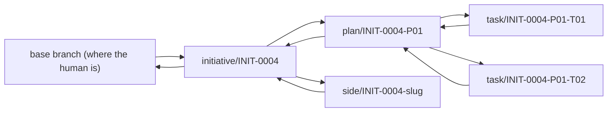

# Branch Model

One branch per artifact level, named after the artifact's ID, merged on
the gate its level requires. `git branch --list` is the registry. The
engine enforces the *outcome* — a `merge` payload names `plan` and
`merge_sha`, and `executor ingest` verifies the plan is known and unmerged
with every task complete and the named merge commit exists — while the
*mechanics* (which fork, which order, which gates) are this document.

## The hierarchy

| Direction | Gate the merge requires |
|---|---|
| task → plan | the task's latest review round's `verdict` is clean — `spec_verdict` pass and `quality_verdict` approved |
| plan → initiative | every task reviewed and merged **and** the plan's final verdict clean — the engine's `MERGE` action; its `merge_sha` is verified on ingest |
| side → initiative | a human `ruling` naming the slug — a side branch is not a task and earns no verdict |
| spike → never | abandoned; never merged |

The **initiative branch** is the only integration line: plan and task
branches never fork from `main` and never merge to it. `hotfix/<slug>` is
the one branch outside the hierarchy — it forks from the base and merges
back, because an urgent fix must not wait for an initiative.

## What the engine enforces, and what stays procedural

The engine today:

- emits `MERGE` only when a plan's fold says every task is merged-ready —
  no `MERGE` for a plan with an open review round;
- verifies the `merge` payload against the fold and git — the plan is
  known and unmerged, every task complete, and the `merge_sha` resolves;
- journaled `abandon`/`spawn_error`/`needs_context` transitions make a
  branch's recorded intent recoverable — the fold knows a task was
  redispatched, so its branch is accounted for even while work is in
  flight.

What stays procedural — the skill's job, not the engine's:

- the fork mechanics (`initiative/<INIT>` from the base, `plan/<PLAN>` from
  the initiative, `task/<TASK>` from the plan tip) — the engine records
  `commit_base`/`commit_head` on verdicts, the skill creates the branches;
- the merge itself, so the recorded `merge_sha` descends from the plan's
  head — the engine checks the commit exists, not where it sits;
- worktree selection for a task that needs isolation;
- the per-task branch lifecycle — forking and abandoning task branches is
  a plan-level policy the execution skill declares per plan, not an engine
  rule yet.

## Sequential plans

A plan whose tasks must land in order declares it in its `sections`
(dependency chains in each task's `files`/`accepts` text) and commits
directly to the plan branch — the sequential mode opts out of per-task
branches, because a single chain is the only case where they add no value.

## Edge cases

| Situation | Handling |
|---|---|
| Task abandoned mid-flight | the `spawn_error`/`abandon` event reverts the task to pending; a `ruling` names why the branch is parked |
| Reviewer needs the task diff | the review package carries `commit_base` (fork point at dispatch) and `commit_head`; the diff is `base..head` |
| Human decides mid-run | a `ruling` payload — not a branch — records it; branches carry code, rulings carry decisions |
| Initiative ends | the initiative branch merges to the base **by the human**, at handoff — the engine stops at the plan boundary |

## Never

- Never delete a branch with unmerged commits — that is a `ruling`
  decision, stated as a cost.
- Never merge a task branch past an unclean verdict.
- Never hand-write a `merge` payload's `merge_sha` from memory — the
  commit must exist and the engine checks.
