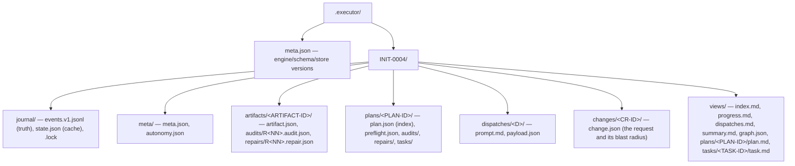
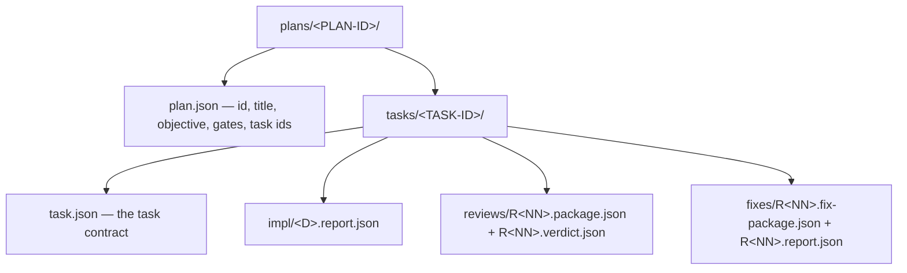
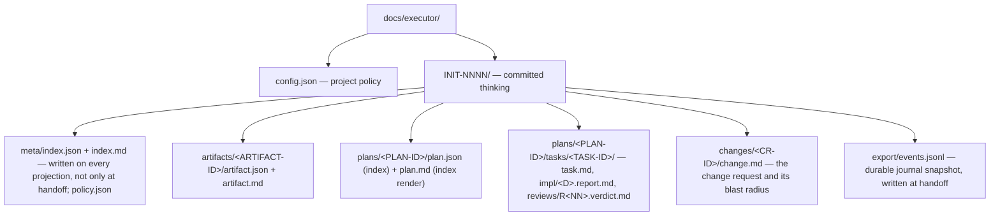

# Directory Layout

The exact structure of both Executor stores. The engine — not this document
— enforces every path here: `scripts/lib/executor/paths.py` is the one path
authority, and `executor check` classifies every file in both stores against
its grammar *and* reports a canonical file that is missing. Nothing invents
a location; nothing is required that the engine does not write.

## Identifiers

| Shape | Names |
|---|---|
| `INIT-NNNN` | an initiative (four digits; `INIT-9999` is the last) |
| `INIT-NNNN-<KIND>-NN` | an artifact; `<KIND>` is one of `CHTR OPTS BRN ARCH ADR IFCE DSGN SPEC RISK VRFY`. `NN` is engine-minted per kind, so a second `ADR` or a per-component `DSGN` has an id |
| `INIT-NNNN-PNN` | a plan, always inside its initiative |
| `INIT-NNNN-PNN-TNN` | a task, always inside its plan |
| `D<NNNNN>` | a dispatch — **the seq of the journal event that minted it**. Five digits is a minimum: event 100000 mints `D100000`. Order dispatches by the number, never by the string |
| `R<NN>` | a round (audit, repair, review, fix, evidence) |
| `CR-NNNN` | a change request, dense per initiative |

A dispatch id is *derived from the journal on purpose*: the id and the
journal cannot disagree, and an id never collides with a future event
because that sequence number is already spent. The gaps are the run's other
events — `views/dispatches.md` and `executor graph` say so in one line.

## Identifiers that are not citable

Only `INIT-NNNN-<KIND>-NN`, `INIT-NNNN-PNN`, `INIT-NNNN-PNN-TNN`, and the
inner ids an artifact declares (`R<n>` requirement, `C<n>` constraint,
`V<n>` criterion, and a component id) may appear in a `cites` list. A
composite such as `INIT-0004-SPEC-01-R07` is not an id; cite `R07` and let
the artifact that declares it anchor the reference. A charter is the one
exception: it may cite another initiative's id, which is shape-checked and
recorded but never resolved against this store.

## Execution store — `.executor/` (machine-local)





**The journal is the state.** `state.json`, the `views/` tree, and the docs
store below are derived projections. `executor check` refolds the journal,
re-renders the committed index and compares bytes, and flags any projection
that disagrees with it. A hand-edit to a view is not state; an event
appended to `events.v1.jsonl` is.

**The plan is an index; the task is a file.** `plan.json` carries the plan's
own fields and its task list as ids, titles and dependencies. Each task's
contract lives in `tasks/&lt;TASK-ID&gt;/task.json`, written when the plan is
authored — so a plan whose tasks have not run has the same shape as one whose
tasks have, and reading one task never parses a mega-file.

**A dispatch is single-use, and the journal says so.** There is no slot
file. `prompt.md` is the worker's rendered brief — it carries `dispatch_id`,
`respond_to`, the schema to emit, the rules the dispatch was minted under,
and the entity's contract. `payload.json` is the `respond_to` path the worker
fills and `executor ingest` validates. Openness is derived from the journal's
`answered` map, never from a file, so a lost directory costs a prompt, not a
state.

**A view leaf has one owner.** `views/tasks/<TASK-ID>/task.md` carries every
round of that task; `views/plans/<PLAN-ID>/plan.md` carries that plan. The
per-round files of the previous layout are gone, so the tree is
`O(entities)`, not `O(rounds)`, and `views/index.md` names every leaf.

**Every view is deterministic.** A view stamps the run's own clock — the
journal tip — never the wall clock, so rendering one journal twice writes
identical bytes. That is what makes a drift check possible.

## Thinking store — `docs/executor/` (git-tracked)



The two stores are not interchangeable. `.executor/` is machine-local; the
committed store is what a reader of the repository sees. Its index is a pure
function of the fold and is written mid-run, so the record is usable before
handoff — and `executor check` fails a committed index that a re-render
disagrees with.

## Artifact kinds

| Kind | ID segment | Written by | Purpose |
|---|---|---|---|
| `charter` | `CHTR` | intake AUTHOR | Problem, goals, non-goals, success criteria, scope |
| `options` | `OPTS` | discovery AUTHOR | Approaches compared, with a recommendation |
| `brainstorm` | `BRN` | discovery AUTHOR (session record) | A design dossier or decision record |
| `arch` | `ARCH` | architecture AUTHOR | System structure, components, boundaries, data flow |
| `adr` | `ADR` | architecture AUTHOR | One decision; one instance per decision, `-01`, `-02`, … |
| `ifce` | `IFCE` | architecture AUTHOR | Contracts between components |
| `design` | `DSGN` | design AUTHOR | One component's internals; the phase mints one design per entry in the architecture's `components` list, and each design names its `component` |
| `spec` | `SPEC` | specification AUTHOR | The requirements contract a plan argues from |
| `risk` | `RISK` | specification AUTHOR | Risk register, pre-mortem output |
| `vrfy` | `VRFY` | specification AUTHOR | Acceptance criteria and how they get proven |

A plan is not an artifact kind — it is a plan (`INIT-NNNN-PNN`), authored by
the planning AUTHOR. An architecture payload *may* declare `components:
[{id, title, responsibility}]`; when it does, the design phase mints one
design artifact per component and binds each draft to its component through
the dispatch context. With no `components` the phase mints exactly one
design, which is what every pre-existing store does.

## Payload kinds

A payload is the only unit a worker, a human, or the engine can append to
the journal, and every kind has a schema in `scripts/lib/executor/schemas.py`:

| Kind | Actor | Closes a dispatch? |
|---|---|---|
| `report`, `audit`, `verdict`, `evidence`, artifact kinds | the bound worker | yes — its `dispatch_id` answers the slot |
| `heartbeat` | the bound worker | no — liveness only (`NON_ANSWERING`) |
| `needs_context`, `spawn_error` | the bound worker | no — `needs_context` frees the task to `ASK`; `spawn_error` reverts it to pending |
| `merge` | the pump, after the human's merge | no — slot-free; it claims `plan` + `merge_sha` + `branch` and the engine checks the merge contains every task head |
| `gate_decision`, `ruling`, `resume`, `halt`, `change_request` | the human, via `executor decide` / `executor change` | n/a — `executor ingest` refuses them all as `unauthorized` |
| `created`, `phase_entered`, `gate_opened`, `task_dispatched`, `abandon`, `preflight`, `policy`, `change_scoped`, `change_applied` | the engine | n/a — `ingest` cannot accept them at all |

A `halt` is the human's alone: a worker that could latch one could stop
every other worker. While it is latched, `ruling` and `resume` are the only
kinds ingest accepts.

A `change_request` is the only way to change the contract mid-run. It names
the ids that changed, the engine computes the blast radius from the fold and
drives the regression lane; see the mid-run change protocol. It is not a
`ruling` and not a markdown edit.

## Dispatch registry

Every subagent the workflow dispatches has exactly one row here: the role
the engine mints, the payload kind it answers with, and the **dedicated
prompt template** the controller prepends to the engine's rendered brief
(`dispatches/<D>/prompt.md` carries `dispatch_id`, `respond_to`, the schema
to emit, the rules it was minted under, and the entity's contract). A
dispatch whose role has no row is not part of the workflow.
`scripts/validate_skills.py` enforces this table: every named template must
exist and carry the dispatch contract (`respond_to`, `dispatch_id`, `kind`),
and every `*-prompt.md` file must be named here.

| Engine role | Emitted kind | Prompt template | Bound to |
|---|---|---|---|
| `author` | the artifact kind for the phase (`charter`, `options`, `brainstorm`, `arch`, `adr`, `ifce`, `design`, `spec`, `risk`, `vrfy`, `plan`) | `executor/author-prompt.md` | the artifact entity |
| `audit` (artifact) | `audit` | `executor-critique/component-auditor-prompt.md` | the artifact under critique |
| `repair` (artifact) | the artifact kind it redrafts (round echoes the audit) | `executor-critique/component-repairer-prompt.md` | the same entity |
| `audit` (artifact re-audit) | `audit` with the next `round` | `executor-critique/component-reauditor-prompt.md` | the same entity |
| `audit` (plan) | `audit` | `executor-plan-regression/plan-auditor-prompt.md` | the plan under critique |
| `repair` (plan) | `plan` | `executor-plan-regression/plan-repairer-prompt.md` | the same entity |
| `audit` (plan re-audit) | `audit` with the next `round` | `executor-plan-regression/plan-reauditor-prompt.md` | the same entity |
| `impl` | `report` | `executor-execution/implementer-prompt.md` | one task |
| `fix` | `report` | `executor-execution/implementer-prompt.md` with the fix preamble | the task's fix round |
| `review` (round 1) | `verdict` | `executor-review/task-reviewer-prompt.md` | one task's round |
| `review` (later rounds) | `verdict` | `executor-review/re-review-prompt.md` | one task's round |
| `audit` (whole plan, `review` phase) | `audit` | `executor-review/final-reviewer-prompt.md` | the plan branch as one change, once per merged plan |
| `evidence` | `evidence` | `executor-verification/evidence-runner-prompt.md` | one VRFY criterion |
| *(preamble)* — revive/redispatch instructions | — | `executor/revive-preamble.md` | the abandoned dispatch |

The regression lane reuses the `repair` row: a change-driven redraft is a
repair whose context carries `change`, `change_summary` and the changed ids,
and whose repair record names the change beside `addressed`. No new role and
no new template.

The brainstorm session's `SCOUT`/`EXPLORE`/`CRITIC` lanes are session
dispatches inside one `brainstorm` artifact's context, not engine roles, and
they are registered here so the registry stays exhaustive even though the
engine mints no slot for them: what they briefed is now answered by the
human through `executor decide`, which journals the `ruling` payload with
`actor: human`. The templates remain as the checklist a human answers with —
each carries the payload contract its answers fill.

| Lane | Emitted kind | Prompt template | Bound to |
|---|---|---|---|
| scout (prior art) | none — the session file is merged by the `author` payload | `executor-brainstorm/prior-art-scout-prompt.md` | the session's scope |
| explorer (concept lens) | none — the session file is merged by the `author` payload | `executor-brainstorm/concept-explorer-prompt.md` | one concept letter |
| critic (stress round) | none — the session file is merged by the `author` payload | `executor-brainstorm/design-critic-prompt.md` | the concepts under stress |

`executor/decide-prompt.md` and `executor/supervisor-prompt.md` carry no
engine dispatch: a `ruling` is a human-only kind, so what they brief is
answered by the human through `executor decide`, which journals the `ruling`
payload with `actor: human`.

| Human lane | Emitted kind | Prompt template | Bound to |
|---|---|---|---|
| decision intake | `ruling`, `gate_decision`, or `resume` | `executor/decide-prompt.md` | the decision the fold is blocked on |
| supervision of an autonomous run | `ruling` when the run needs a call | `executor/supervisor-prompt.md` | the phase's open decisions |
| contract change | `change_request` | — (a schema, not a template) | the ids that changed |

## Path resolution

Never hand-build a path. Everything you need arrives in the action
`executor next` emits (`respond_to`, `prompt`, `context`) or under the
canonical names `executor status`, `executor check`, and `executor graph`
print. If you find yourself constructing a path, that reasoning belongs to
the engine — record a `concern` and stop.

## Markdown rendering rules

Every generated markdown file must render correctly in any common renderer.
Four rules keep that true:

1. **Generated markdown contains no HTML comments.** A comment between a
   table's header and its rows splits the table in most renderers —
   guidance is written as visible italic lines; an unfilled one is a defect
   a reader can see.
2. **Appends never land inside a table.** Log-style lines append as table
   rows directly under the last row, or as list lines in their own section —
   never after a trailing note or a blank section end.
3. **Committed views open with YAML frontmatter** (see the frontmatter
   contract), so an agent reading one file cold can identify it without
   opening anything else.
4. **Every diagram is Mermaid; ASCII art is never a diagram.**
   `scripts/validate_skills.py` fails any box-drawing character in markdown
   outside an inline code span.

## Migration between layouts

A store from the previous layout is refused by the writer (`store_outdated`)
rather than half-converted, and converted by one engine command:

```
executor migrate --dry-run     # every write and removal, touching nothing
executor migrate --apply       # write, verify, stamp store_version v2
```

The migration reads the journal and folds it: every file it writes is a pure
function of the journal, so a second `--apply` rewrites identical bytes and
removes nothing. `scripts/migrate_layout.py` is the same implementation from
the command line.

## What is never deleted

Nothing in either store is deleted by a skill. When a plan finishes, its plan
directory stays; when an initiative finishes, its folder stays and its
journal snapshot exports to `export/events.jsonl`. Pruning is a human
decision, taken deliberately, never a cleanup step. The one exception is the
migration above, which removes the files the new grammar no longer admits —
a projection change, spelled out in its `--dry-run` output before it runs.
