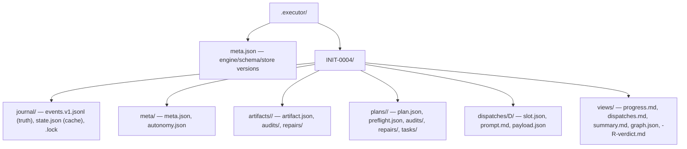
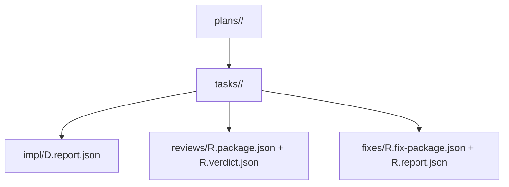
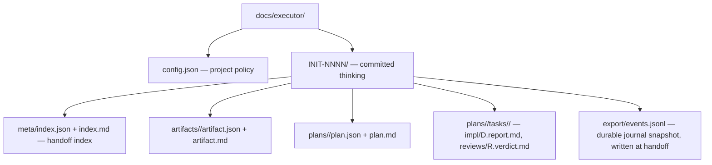

# Directory Layout

The exact structure of both Executor stores. The engine — not this document
— enforces every path here: `scripts/lib/executor/paths.py` is the one path
authority, and `executor check` classifies every file in both stores
against its grammar. Nothing invents a location.

## Identifiers

| Shape | Names |
|---|---|
| `INIT-NNNN` | an initiative |
| `INIT-NNNN-<KIND>-NN` | an artifact; `<KIND>` is one of `CHTR OPTS BRN ARCH ADR IFCE DSGN SPEC RISK VRFY` |
| `INIT-NNNN-PNN` | a plan, always inside its initiative |
| `INIT-NNNN-PNN-TNN` | a task, always inside its plan |
| `D<NNNNN>` | a dispatch — the seq of the journal event that minted it |
| `R<NN>` | a round (audit, repair, review, fix, evidence) |

## Execution store — `.executor/` (git-ignored, machine-local)

**The journal is the state.** `state.json`, the `views/` files, and the
docs store below are derived projections; `executor check` refolds the
journal and flags any projection that disagrees with it. A hand-edit to a
view is not state; an event appended to `events.v1.jsonl` is.

**A dispatch is single-use.** `dispatches/D<NNNNN>/slot.json` is minted by
the engine exactly once; `prompt.md` is the worker's rendered brief;
`payload.json` is the `respond_to` path the worker fills and
`executor ingest` validates against its `kind`'s schema. A heartbeat or a
`task_dispatched` echo does not close the slot — openness is derived from
the journal (`answered` map), never from a mutable flag file.

## Thinking store — `docs/executor/` (git-tracked)

The two stores are not interchangeable. `.executor/` is machine-local and
self-cleaning; `docs/executor/` commits on the branch that produced the
thinking. A verdict, report, or brief that lands in `docs/executor/`
outside the committed projections above is a contract violation
`executor check` reports — it pollutes the tracked thinking record with
execution noise.

## Artifact kinds

| Kind | ID segment | Written by | Purpose |
|---|---|---|---|
| `charter` | `CHTR` | intake AUTHOR | Problem, goals, non-goals, success criteria, scope |
| `options` | `OPTS` | discovery AUTHOR | Approaches compared, with a recommendation |
| `brainstorm` | `BRN` | discovery AUTHOR (session record) | A design dossier or decision record |
| `arch` | `ARCH` | architecture AUTHOR | System structure, components, boundaries, data flow |
| `adr` | `ADR` | architecture AUTHOR | One decision: context, options, choice, consequences |
| `ifce` | `IFCE` | architecture AUTHOR | Contracts between components |
| `design` | `DSGN` | design AUTHOR | One component's internals |
| `spec` | `SPEC` | specification AUTHOR | The requirements contract a plan argues from |
| `risk` | `RISK` | specification AUTHOR | Risk register, pre-mortem output |
| `vrfy` | `VRFY` | specification AUTHOR | Acceptance criteria and how they get proven |

A plan is not an artifact kind — it is a plan (`INIT-NNNN-PNN`), authored
by the planning AUTHOR.

## Payload kinds

A payload is the only unit a worker, a human, or the engine can append to
the journal, and every kind has a schema in `scripts/lib/executor/schemas.py`:

| Kind | Actor | Closes a dispatch? |
|---|---|---|
| `report`, `audit`, `verdict`, `evidence`, artifact kinds, `merge` | the bound worker | yes — its `dispatch_id` answers the slot |
| `heartbeat` | the bound worker | no — liveness only (`NON_ANSWERING`) |
| `needs_context`, `spawn_error` | the bound worker | no — `needs_context` frees the task to `ASK`; `spawn_error` reverts it to pending |
| `gate_decision`, `ruling`, `resume` | the human, via `executor decide` | n/a — `executor ingest` refuses them as `unauthorized` |
| `halt` | the human | n/a — latches until `resume` |
| `created`, `phase_entered`, `gate_opened`, `task_dispatched`, `abandon`, `preflight`, `policy` | the engine | n/a — `ingest` cannot accept them at all |

While `halt` is latched, `ruling` and `resume` are the only kinds ingest
accepts — the latch survives everything else.

## Dispatch registry

Every subagent the workflow dispatches has exactly one row here: the role
the engine mints, the payload kind it answers with, and the **dedicated
prompt template** the controller prepends to the engine's rendered brief
(`dispatches/D<NNNNN>/prompt.md` carries `dispatch_id`, `respond_to`, the
schema to emit, and the entity's contract). A dispatch whose role has no
row is not part of the workflow. `scripts/validate_skills.py` enforces
this table: every named template must exist and carry the dispatch
contract (`respond_to`, `dispatch_id`, `kind`), and every `*-prompt.md`
file must be named here.

| Engine role | Emitted kind | Prompt template | Bound to |
|---|---|---|---|
| `author` | the artifact kind for the phase (`charter`, `options`, `brainstorm`, `arch`, `adr`, `ifce`, `design`, `spec`, `risk`, `vrfy`, `plan`) | `executor/author-prompt.md` | the artifact entity |
| `audit` (artifact) | `audit` | `executor-critique/component-auditor-prompt.md` | the artifact under critique |
| `repair` (artifact) | the artifact kind it redrafts (round echoes the audit) | `executor-critique/component-repairer-prompt.md` | the same entity |
| `audit` (artifact re-audit) | `audit` with the next `round` | `executor-critique/component-reauditor-prompt.md` | the same entity |
| `audit` (plan) | `audit` | `executor-plan-regression/plan-auditor-prompt.md` | the plan under critique |
| `repair` (plan) | `plan` | `executor-plan-regression/plan-repairer-prompt.md` | the same entity |
| `audit` (plan re-audit) | `audit` with the next `round` | `executor-plan-regression/plan-reauditor-prompt.md` | the same entity |
| `impl` | `report` | `executor-execution/implementer-prompt.md` | one task |
| `fix` | `report` | `executor-execution/implementer-prompt.md` with the fix preamble | the task's fix round |
| `review` (round 1) | `verdict` | `executor-review/task-reviewer-prompt.md` | one task's round |
| `review` (later rounds) | `verdict` | `executor-review/re-review-prompt.md` | one task's round |
| `audit` (whole plan) | `audit` | `executor-review/final-reviewer-prompt.md` | the plan branch as one change |
| `evidence` | `evidence` | `executor-verification/evidence-runner-prompt.md` | one VRFY criterion |
| *(preamble)* — revive/redispatch instructions | — | `executor/revive-preamble.md` | the abandoned dispatch |

The brainstorm session's `SCOUT`/`EXPLORE`/`CRITIC` lanes are session
dispatches inside one `brainstorm` artifact's context, not engine roles,
and they are registered here so the registry stays exhaustive even though
the engine mints no slot for them: the controller records their
dispatches in the session's `Dispatch log` and merges their output into
the artifact's `sections` on commit.

| Lane | Emitted kind | Prompt template | Bound to |
|---|---|---|---|
| scout (prior art) | none — the session file is merged by the `author` payload | `executor-brainstorm/prior-art-scout-prompt.md` | the session's scope |
| explorer (concept lens) | none — the session file is merged by the `author` payload | `executor-brainstorm/concept-explorer-prompt.md` | one concept letter |
| critic (stress round) | none — the session file is merged by the `author` payload | `executor-brainstorm/design-critic-prompt.md` | the concepts under stress |

`executor/decide-prompt.md` and `executor/supervisor-prompt.md` carry no
engine dispatch: a `ruling` is a human-only kind, so what they briefed is
now answered by the human through `executor decide`, which journals the
`ruling` payload with `actor: human`. The templates remain as the
checklist a human answers with — each carries the payload contract its
answers fill.

| Human lane | Emitted kind | Prompt template | Bound to |
|---|---|---|---|
| decision intake | `ruling`, `gate_decision`, or `resume` | `executor/decide-prompt.md` | the decision the fold is blocked on |
| supervision of an autonomous run | `ruling` when the run needs a call | `executor/supervisor-prompt.md` | the phase's open decisions |

## Path resolution

Never hand-build a path. Everything you need arrives in the action
`executor next` emits (`respond_to`, `prompt`, `context`) or under the
canonical names `executor status`, `executor check`, and `executor graph`
print. If you find yourself constructing a path, that reasoning belongs to
the engine — record a `concern` and stop.

## Markdown rendering rules

Every generated markdown file must render correctly in any common
renderer. Four rules keep that true:

1. **Generated markdown contains no HTML comments.** A comment between a
   table's header and its rows splits the table in most renderers —
   guidance is written as visible italic lines; an unfilled one is a
   defect a reader can see.
2. **Appends never land inside a table.** Log-style lines append as table
   rows directly under the last row, or as list lines in their own
   section — never after a trailing note or a blank section end.
3. **Committed views open with YAML frontmatter** (see the frontmatter
   contract), so an agent reading one file cold can identify it without
   opening anything else.
4. **Every diagram is Mermaid; ASCII art is never a diagram.**
   `scripts/validate_skills.py` fails any box-drawing character in
   markdown outside an inline code span.

## What is never deleted

Nothing in either store is deleted by a skill. When a plan finishes, its
plan directory stays; when an initiative finishes, its folder stays and
its journal snapshot exports to `export/events.jsonl`. Pruning is a human
decision, taken deliberately, never a cleanup step.
